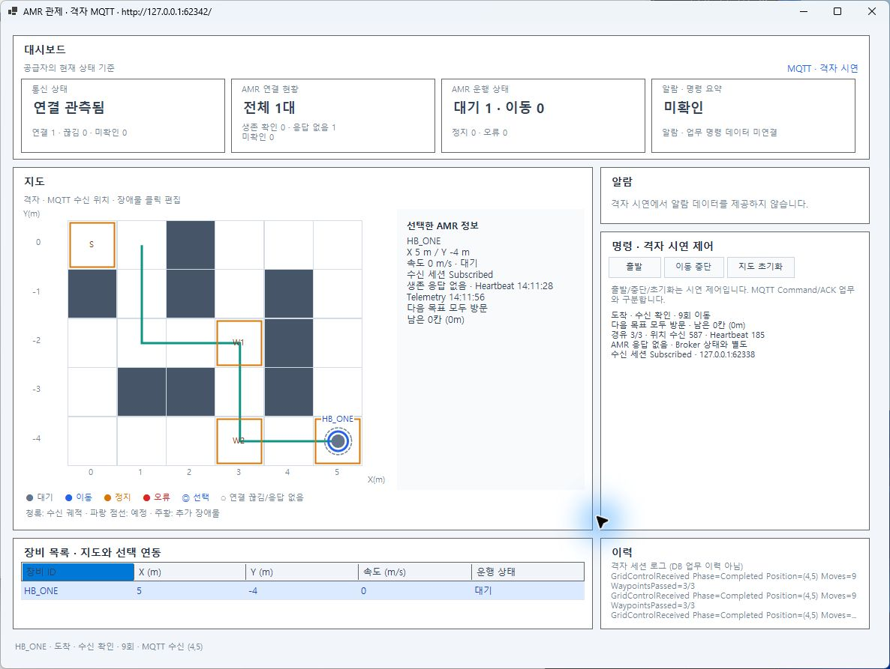
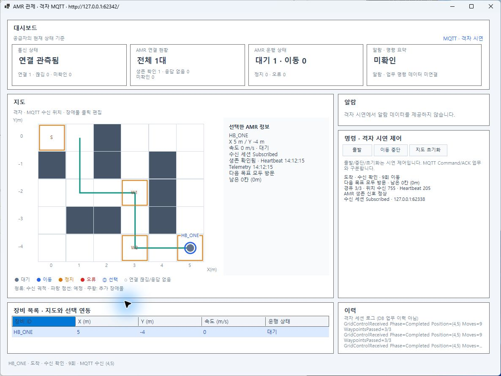
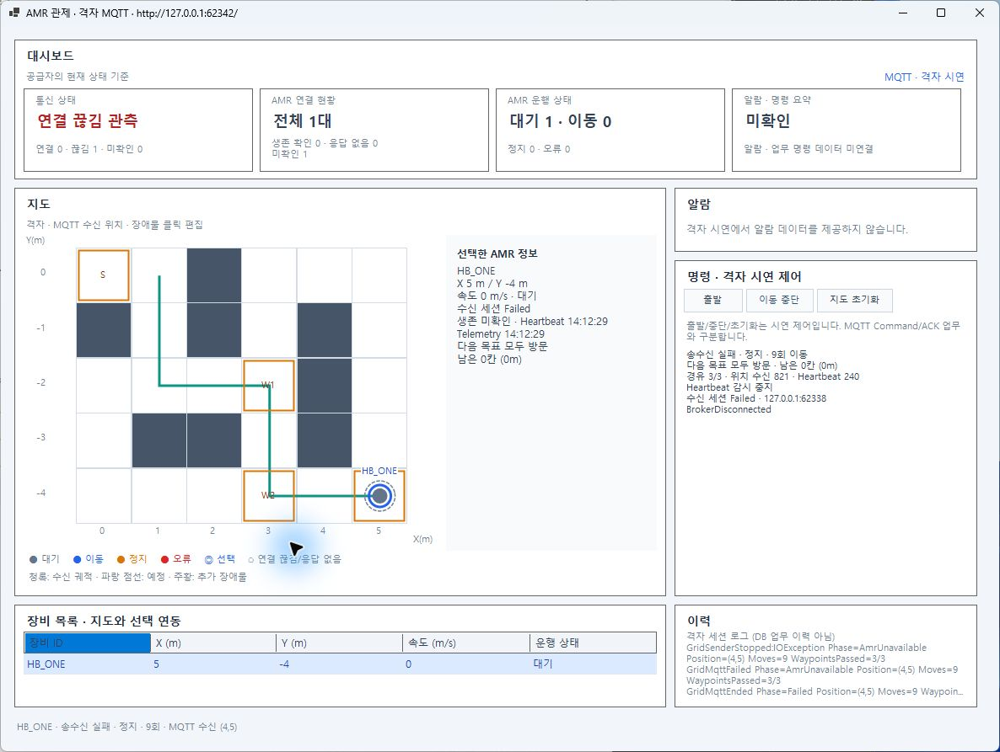

# 단일 AMR Heartbeat 감시·GUI 연결 검증

2026-10-27 사용자 요청 범위의 **로컬 구현·검증 완료**. 커밋·스테이징·푸시·PR·병합은 하지 않았다. COM-02 전체나 과제1 전체 완료를 뜻하지 않는다.

| 항목 | 기준·실제 결과 |
| --- | --- |
| 실행 ID | `20261027-heartbeat-one-01` |
| 코드 | `feature/46-grid-map-integration`, HEAD `4e44fa880cb0d1fcccb000dbc53e634fd90381b5` 위 미커밋 변경. [최종 파일별 SHA256](final-source-manifest.json) |
| 계약 | 원본 기능명세 COM-02·결정 D-09/DN-10·과제1 COM02-A 개발 계약. 첫 정상 Heartbeat부터 Timeout5초/확인500ms·단조 경과>=Timeout, 중단당 Timeout1회·정상 재수신 복구1회. 최종 업무 Offline/FAULT와 구분 |
| 환경 | Windows 10.0.26200, .NET SDK10.0.401/net10.0, PowerShell7.6.5, MQTTnet5.2.0.1603, Mosquitto2.1.2-alpine. Windows Forms 실제 창 |
| 실제 MQTT 입력 | 별도 소유 Broker `127.0.0.1:62338`, AMR `HB_ONE`, Telemetry100ms·Heartbeat200ms·이동100ms. 제품 기본600ms·200/1000ms 설정은 유지 |
| 보존 | [최종 감사](final-audit.json): 기존 소스165 중145 불변·20 요청 범위 변경, Core/Mock 불변. 원래 미추적50·stash·보존 브랜치·백업4개 해시 불변. [작업 전 ZIP](before-source.zip)165항목 모두 baseline 해시로 복구 가능 확인 |

## 구현 결과와 선택 이유

- Communication의 `SingleAmrHeartbeatMonitor`가 한 ID의 상태·시각·통지 횟수만 잠금으로 보호한다. 타이머는 수신 세션 소유다. UTC는 표시·로그, 경과 판단은 `TimeProvider.GetTimestamp`를 사용한다. 첫 수신 전에는 AwaitingFirst이며 업무 Offline으로 추론하지 않는다.
- `MessageSubscription`은 검사/큐 처리 전 최초 UTC·단조 수신 시각을 확보하고, 검사에 통과한 Heartbeat만 큐 접수 전에 감시에 전달한다. Telemetry·불량 메시지·다른 AMR은 대상의 생존을 갱신하지 않는다. 기존 검사·큐·콜백 실패 격리 계약을 유지한다.
- 지도 호스트의 관제 수신 Client와 AMR 송신 Client는 별도다. Ready·차단 대기·도착·이동 중단·초기화는 임무 상태이며 통신 세션을 종료하지 않는다. 호스트 종료/Broker 단절은 감시·송신을 취소하고 실제 종료를 기다린다. AMR 송신 실패만 발생하면 독립 관제 연결과 감시를 유지한다.
- 최종 정지 발행/수신 확인은 `missionFinalTelemetry`와 `missionFinalReceived`에 고정한다. 이후 주기 Telemetry의 발행 시각은 계속 바뀐다. 임무 세대 번호와 발행 당시 스냅샷으로 초기화 전의 늦은 완료 알림을 배제한다. 초기화는 다음 실제 Telemetry로 위치를 갱신하고 수신 건수는 유지한다.
- GUI는 같은 수신 프레임으로 `Broker 연결`과 `AMR 생존 정상/응답 없음/미확인`을 따로 표시한다. 무응답·Broker 단절만으로 마지막 Telemetry의 IDLE/BUSY·위치·속도를 변경하지 않는다. 기존 Core·Mock·다섯 영역 배치를 보존한다.

### 대안·전환 조건

현재 한 AMR에는 단일 감시 객체+주기 검사 하나가 상태/종료 책임을 가장 적게 만든다. 여러 AMR에 각각 타이머를 두면 개별 격리는 쉬우나 장비 수만큼 타이머·정리 책임이 늘어난다. 여러 ID의 사전+한 검사 루프는 공유 상태 관리가 추가되는 대신 타이머 수를 제한할 수 있다. 다중 AMR을 요청하면 등록/해제·ID별 장애·부하 근거부터 마련한다. 대안의 성능 벤치마크는 수행하지 않았다.

단일 AMR 송신 루프는 이동·Telemetry·Heartbeat의 순서와 종료를 단순하게 유지한다. 네트워크 발행이 느리면 다음 Heartbeat도 늦을 수 있다. 실제 지연/부하에서 정상 신호 주기를 만족하지 못한다는 근거가 생기면 송신 분리와 버퍼/취소 정책을 검토한다. 자동 재접속·무한 재시도·DB·분산 보장은 추가하지 않았다.

### 예상 리뷰 질문

1. **Telemetry가 계속 오는데 왜 응답 없음인가?** 채택한 계약이 정상 Heartbeat만 생존 근거로 삼는다. 실제 Heartbeat 차단 시험에서도 Telemetry343→388 수신 중 무응답을 확인했다. 화면에 Broker 상태와 별개임을 표시한다.
2. **도착하면 왜 연결을 끊지 않는가?** 임무 완료와 AMR 통신 생존은 수명이 다르다. 도착 후 정지 Telemetry와 Heartbeat를 유지하고, 최종 수신 완료는 고정된 별도 값으로 보관한다.
3. **Broker 장애가 AMR Timeout으로 중복 집계되지 않는가?** 수신 Client 단절에서 감시를 먼저 중지한다. 실제 Broker 중단 후5.5초 관찰에도 Timeout2/복구2가 유지됐다. 마지막 업무 상태로 실제 로봇 정지를 보장하지는 않는다.

## 자동 시험

고유 시험 총 **1,095개 통과**, 실패/건너뜀0. 여러 실행을 중복 합산하지 않았다. 기존 통신·Mock 시험을 포함한다.

| 시험 | 결과 | 이번 근거 |
| --- | --- | --- |
| Communication | 778 통과 | [TRX](tests/Amr.Communication.Tests-03.trx) · [로그](Amr.Communication.Tests-03.log) |
| Simulator | 202 통과 | [TRX](tests/Amr.Simulator.Tests-04.trx) · [로그](Amr.Simulator.Tests-04.log) |
| Windows Forms/Mock | 49 통과 | [최종 TRX](tests/Gui-final.trx) · [로그](Gui-final.log) |
| Map | 66 통과 | [최종 TRX](tests/Map-final.trx) · [로그](Map-final.log) |
| 솔루션 빌드 | 경고0·오류0 | [최종 빌드](build-final.log) |

제어 시계로5초 직전/동일 경계·중복 Timeout·재수신·UTC 점프·이전 수신 시각·Stop/새 세션을 확인했다. 큐 처리 실패 전 감시 갱신, 최초 시각 보존, GUI Broker/생존/업무 상태 분리, 지속 송신·종료 대기·초기화와 최종 발행 경합·송신 실패 격리를 확인했다. 최종 Map 변경 후66건을 재실행했고 다른 모듈의 소스가 같은 시험 근거는 재사용했다.

빌드/시험은 `-c Release -p:OutputPath=bin/HeartbeatVerify/`를 사용해 기존 Debug/Release 사용자 실행 파일과 분리했다. `--no-build` 시험에도 같은 OutputPath를 지정했다. 시험 호스트 실행에는 이 환경의 소켓 접근 제한 밖 실행을 사용했다.

## 실제 MQTT·GUI 입력/예상/실제/판정

시험 전용 `HeartbeatProbe`는 **실제** `GridMapSession`·관제 구독·Validator·큐·감시를 사용한다. 송신 전송 계층에서 선택한 신호만 버리는 장치를 주입한다. GUI는 제품 실행 파일로 그 API에 연결했다. 감시 상태/시각을 시험 값으로 주입하지 않았다. `GridPublished`는 전송 시도 기록이므로 단독 수신 성공 근거로 사용하지 않는다.

| 입력 | 예상 | 실제·판정 | 근거 |
| --- | --- | --- | --- |
| 출발 전 Ready 1.2초 | 이동0·Heartbeat 지속 | 63→69, 생존 정상·통과 | [Ready](01-ready.json) |
| (1,1) 차단 후 출발·대기1.2초 | 이동0·IDLE·신호 지속 | Heartbeat70→75·Alive·통과 | [Waiting](02-waiting.json) |
| 해제 후 W1→W2→G 도착·1.2초 추가 | 9회·수신(5,-4)·IDLE/0·통신 지속 | 최종 수신 확인·Heartbeat80→86·Subscribed/Alive·통과 | [도착 후 유지](03-arrival-alive.json) |
| Heartbeat만 차단 | 5초 이상 최초 검사에 무응답, Broker/Telemetry 지속 | 마지막 신호 후5403ms 최초 API 관측·Timeout1·Telemetry343→388·통과 | [무응답](04-NoHeartbeat.json) |
| 무응답 중 불량/다른 ID Heartbeat 주입 | 대상 복구 없음 | 거부1 증가·복구0·Unresponsive 유지·통과 | [격리](05-invalid-other-isolation.json) |
| 신호 재개 | 복구1회 | Alive·Timeout1/복구1·통과 | [복구](06-Recovery.json) |
| 전체 AMR 신호 차단 | Broker 유지·수신 증가 없음·무응답 | 5169ms 최초 API 관측·Timeout2/복구1·통과 | [전체 송신 중단](04-Silent.json) |
| 전체 신호 재개 | 두 번째 복구1회 | Alive·Timeout2/복구2·통과 | [재복구](06-Recovery2.json) |
| 소유 Broker만 중단·5.5초 관찰 | 연결 실패·감시 중지·추가 AMR Timeout 없음 | Failed/BrokerDisconnected·Stopped·Timeout2/복구2 유지·마지막 위치/상태 불변·통과 | [Broker 단절](07-broker-loss-stopped-monitor.json) |
| 실제 GUI 정상/무응답/복구/단절 | 연결과 생존을 별도 표시 | 정상1→응답 없음1→정상1→연결 끊김/생존 미확인1·통과 | 아래 원본 화면 |

500ms 검사·API50ms 조회와 실행 지연을 고려해 실제 무응답 최초 관측에는5~6초 허용 범위를 명시했다. 5초 정확 경계는 제어 시계 자동시험으로 검증했다. 초기 기록의 `faultToObservedMs`는 후속 관찰/주입 시간까지 포함한 전체 시나리오 시간이다. 판정은 `firstTimeout.heartbeatMonitor.elapsedMilliseconds`로 했으며 재현 스크립트는 최초 관측과 전체 시간을 별도 기록하도록 보완했다.







`gui-alive.png`는 출발 준비의 정상 화면이다. 일부 최초 AX 관찰은 이전 프레임이었고 `gui-unresponsive.png`는 다른 창에 가려졌다. 이들은 성공 판정에 쓰지 않고, 위 최종 가시 화면과 실제 API/로그로 판정했다. GUI 종료는 창 닫기 시도 뒤 Alt+F4로 확인했으며 최종 소유 GUI 프로세스 종료를 확인했다.

## 기존 격자 회귀·실패 이력·정리

- [실제 격자15개](../../AMR/20261027-hb-grid-regression2/verification.json): 정상9회·우회15회·W2 선통과/정상 방문 순서·목표 차단·대기·불량 격리·중단 후 통신 유지·활성 초기화·Broker 단절·접속 실패·발행/수신/API 좌표 대조 통과.
- [파일 설정6개](../../AMR/20261027-hb-grid-settings/verification.json): 파일만으로 확장 맵·주기·ID 적용, 실제 도착, 파일 수정 후 실행 중 불변/재시작 적용, 불량 설정 거부 통과.
- [첫 격자 회귀 실패](../../AMR/20261027-hb-grid-regression/verification.json)는 시작점 궤적 누락을 발견했다. Ready에서 실제 받은 시작 좌표를 새 궤적에 남기고 새 실행 ID로15개를 다시 통과했다. 계산값으로 수신 좌표를 채우지 않았다.
- 사용자 정의 솔루션 구성 `HeartbeatVerify`는 MSB4126으로 실패했다. Release+OutputPath 분리로 해결했다. 실행 중인 시험 호스트 잠금으로 [빌드06](map-build-06.log)이 실패해 소유 호스트 정상 종료 후 [빌드07](map-build-07.log)·최종 빌드를 통과했다.
- 시험 전용 Probe 복원은 NuGet 취약성 피드 조회 NU1900 경고가 있었으며 허용된 실행으로 재시도해도 캐시 경고가 남았다. 기존 패키지로 빌드·시험을 실행했으며 온라인 취약성 조회 성공으로 표시하지 않는다. 제품 최종 솔루션 빌드는0경고다.
- 보기본 임시 실행기 첫 구문 오류는 [로그](doc-render.log)에 남기고 보완 후 [전체6개 양식 검증·과제1/2/3 보기본 생성](doc-render-final.log)을 통과했다. 제품 시험과 구분한다. 원본 렌더러는 수정하지 않았다.
- [Probe/Broker 정리](cleanup.json), [회귀1 정리](../../AMR/20261027-hb-grid-regression-host/cleanup.json), [회귀2 정리](../../AMR/20261027-hb-grid-regression-host2/cleanup.json): 소유 호스트 정상 종료·소유 Broker 제거·기존 컨테이너 상태 보존. 다른 사용자 서비스를 중단하지 않았다.

## 재현·남은 범위

저장소 루트의 일반 Windows PowerShell7 터미널에서 새 RunId를 사용한다. Docker 엔진과 `eclipse-mosquitto:2.1.2-alpine` 이미지가 필요하다. 제품 기본 GUI 실행은 [BUILDING](../../../BUILDING.md)을 따른다.

```powershell
dotnet build tests/manual/COM02-A/HeartbeatProbe/HeartbeatProbe.csproj -c Release -p:OutputPath=bin/HeartbeatVerify/
pwsh -NoProfile -File tests/manual/COM02-A/Verify-Heartbeat.ps1 -Phase Launch -RunId heartbeat-new
# probe-session.json의 URL로 제품 GUI --grid-url 연결
foreach ($phase in 'Healthy','NoHeartbeat','Recovery','Silent','Recovery2','BrokerDown','Cleanup') {
    pwsh -NoProfile -File tests/manual/COM02-A/Verify-Heartbeat.ps1 -Phase $phase -RunId heartbeat-new
    if ($LASTEXITCODE -ne 0) { break }
}
```

다중 AMR·장시간 부하·실제 AMR 별도 프로세스 강제 종료·물리적 STOP·Core/DB 업무 처리 전체·COM-02 전체·자동 재접속/재구독은 미검증/미구현이다. 실제 신호 차단과 Broker 단절 시험을 실제 로봇/전체 통합 시험으로 확대하지 않는다. 원본 계획/같은 날짜 업무 기록은 `C:\process-plan`에 갱신했다. 두 저장소의 변경은 미커밋 상태다.
