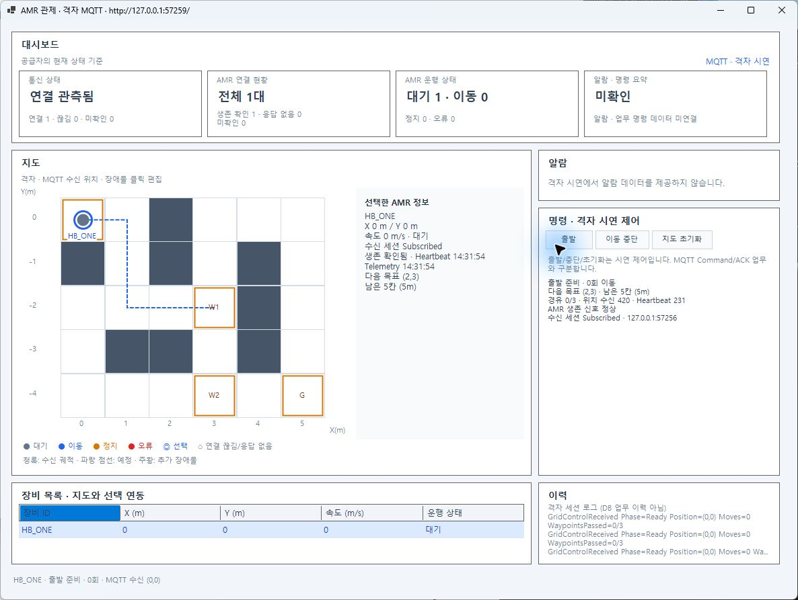
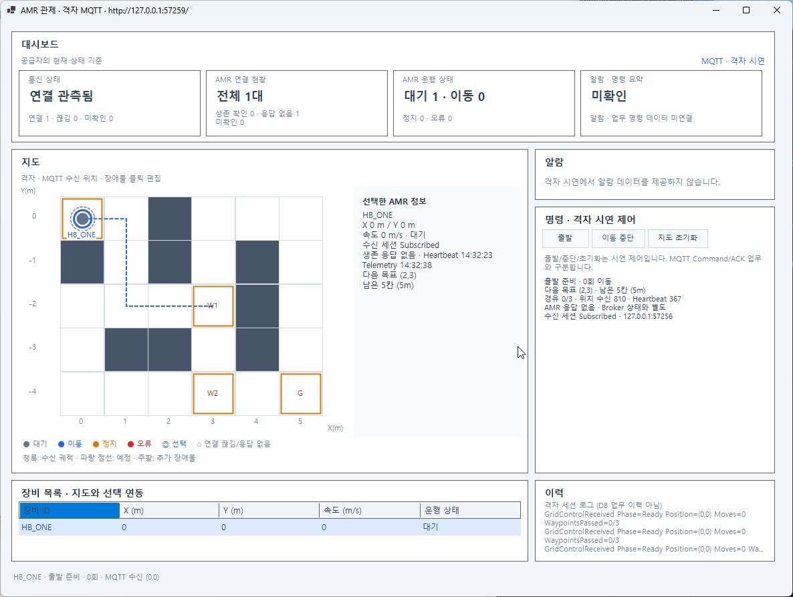
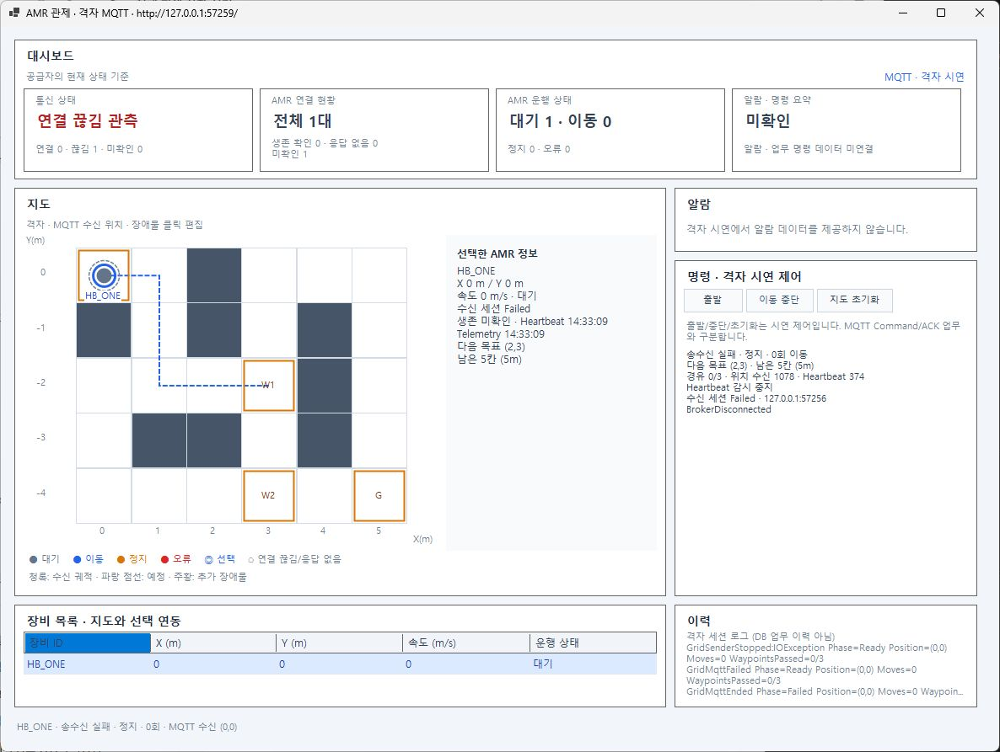

# Heartbeat 세 상태 실제 GUI 시연

2026-10-27 사용자 요청으로 **GUI·시뮬레이터를 실제 실행하여** 정상 → AMR 응답 없음 → 복구 → Broker 단절을 화면에서 확인했다. 제품 소스는 앞선 검증 버전과 같으며 자동시험을 다시 실행한 것으로 집계하지 않는다. [소스/게시 상태 대조](show-summary.json), [기존 상세 검증](../20261027-heartbeat-one-01/README.md)을 연결한다.

| 상태 | 실제 GUI 표시 | 화면·실행 근거 |
| --- | --- | --- |
| Heartbeat 정상 | 통신 연결 관측됨·생존 확인1·응답 없음0, 상세 AMR 생존 신호 정상 | [원본 화면](normal.png) · [출발 전](01-ready.json) · [차단 대기](02-waiting.json) · [도착 후](03-arrival-alive.json) |
| AMR 응답 없음 | 통신 연결 유지·생존 확인0·응답 없음1, 상세 AMR 응답 없음/Broker 상태와 별도. Heartbeat 시각은 멈추고 Telemetry 시각은 갱신 | [원본 화면](unresponsive.png) · [실제 신호 차단](04-NoHeartbeat.json) · [다른ID/불량 격리](05-invalid-other-isolation.json) |
| 신호 복구 | 생존 정상으로 복구·복구 횟수1 증가 | [실제 재개](06-Recovery.json) |
| Broker 단절 | 빨간색 연결 끊김 관측·생존 미확인1·응답 없음0, 상세 Heartbeat 감시 중지/수신 세션 Failed/BrokerDisconnected | [원본 화면](broker-down.png) · [실제 Broker 중단/5.5초 관찰](07-broker-loss-stopped-monitor.json) |







시연 대상은 `HB_ONE`, 실제 Mosquitto2.1.2-alpine 전용 Broker/제품 관제 수신·검사·큐·감시/제품 Windows Forms다. 시험 전용 송신 계층에서 Heartbeat만 차단했다. 해당 Broker만 중단했으며 [시연 정리](cleanup.json)에서 기존 컨테이너 보존을 확인했다. [시연 GUI 종료](gui-exit.json) 후 일반 설정의 정상 시뮬레이터와 GUI를 새로 실행했다. 임시 빌드 로그 복사 경로가 실행 환경별로 달라 한 번 중단됐으며, 이미 생성한 시연 세션을 재사용해 중복 실행 없이 계속했다. UI 관찰 중 사용자 입력 감지 시 상태를 새로 읽고 계속했다.

## 현재 실행 중인 일반 시뮬레이터·GUI

- RunId: `20261027-heartbeat-live-01`, AMR `AMR_001`.
- 지도/API: `http://127.0.0.1:65526`, MQTT Broker: `127.0.0.1:65521`.
- 기본 설정600ms 이동·Telemetry200ms/Heartbeat1000ms, 관제 감시5초/500ms. [호스트 식별 정보](../../AMR/20261027-heartbeat-live-01/session.json) · [GUI 식별 정보](../../AMR/20261027-heartbeat-live-01/gui-session.json) · [최초 정상 상태](../../AMR/20261027-heartbeat-live-01/normal-ready-state.json).
- 사용자가 계속 조작할 수 있도록 정상 연결로 실행해 두었다. 출발·중단·초기화는 GUI에서 사용할 수 있다. 사용자 조작 중인 창의 현재 임무 상태를 고정하지 않는다. 자동 재접속을 검증한 것이 아니라 새 세션을 실행한 것이다.
- 정상 실행을 끝내려면 GUI를 닫고 아래 명령으로 이 호스트·소유 Broker를 정리한다. GUI만 닫으면 호스트는 계속 실행된다.

```powershell
pwsh -NoProfile -File tests/manual/AMR01/Stop-MqttMap.ps1 -RunId 20261027-heartbeat-live-01
```

커밋·푸시·PR·병합은 수행하지 않았고 스테이징도 비어 있다. 기존 보존 자료와 이전 시험 증거는 유지했다.
