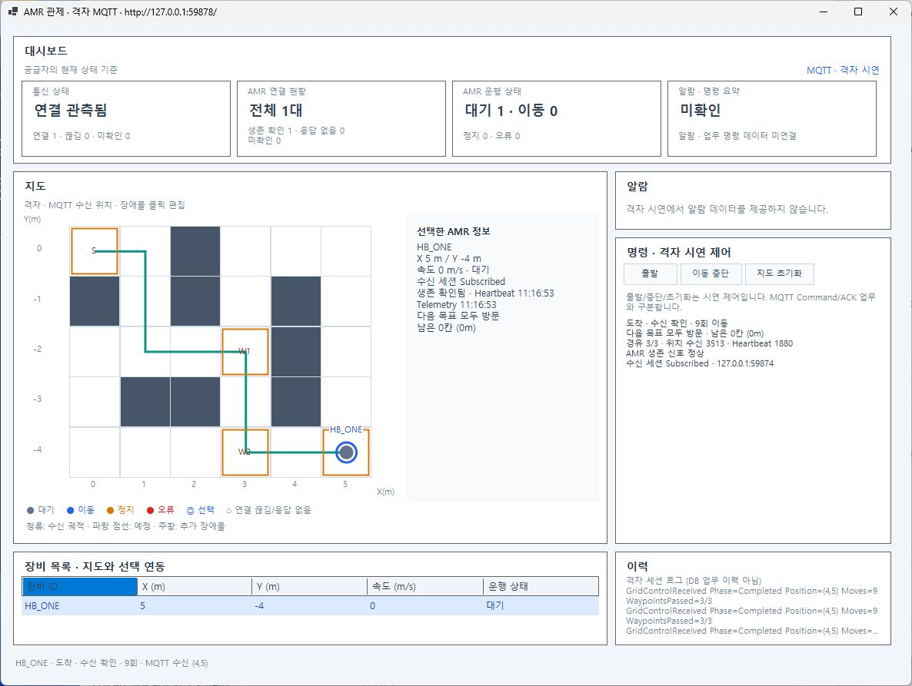
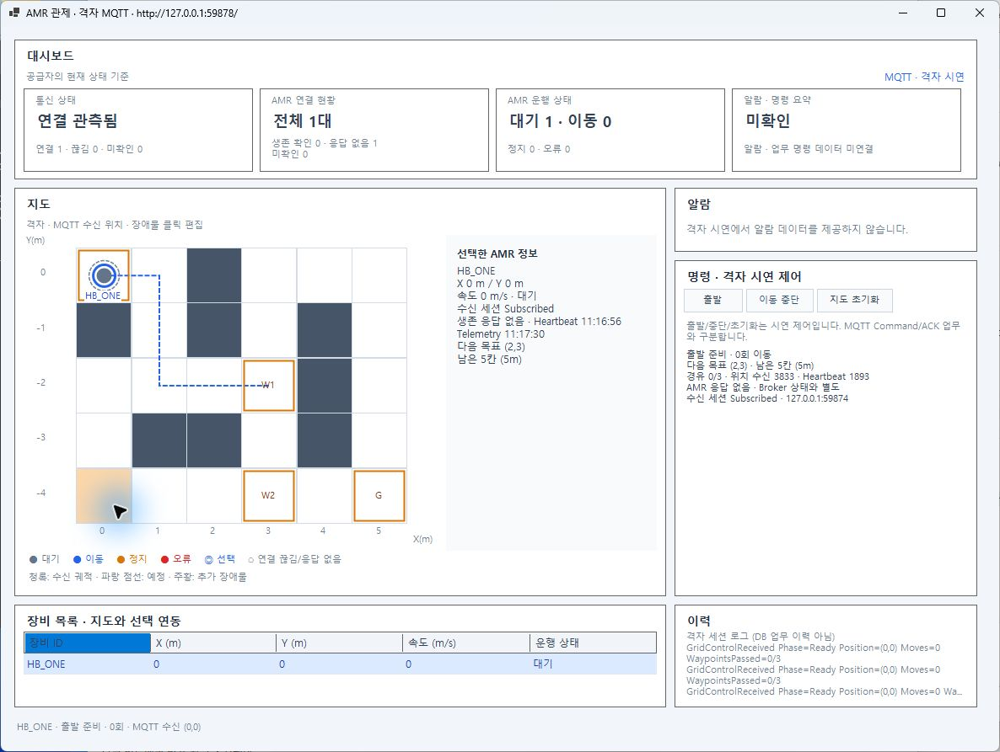
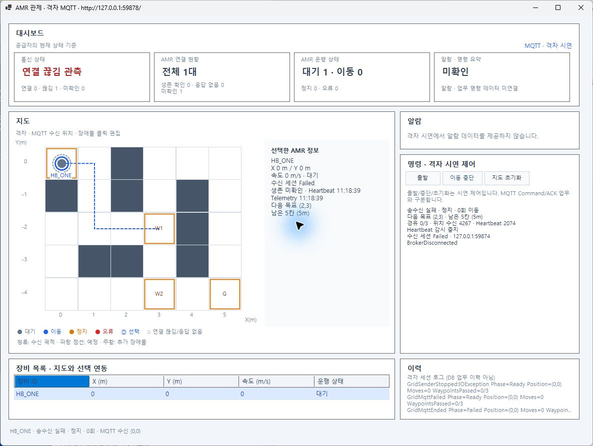

# 단일 AMR 관제 통신 세션 분리 검증

- 실행 ID: `20261028-control-session-01`, 2026-10-28 Asia/Seoul. 직접 수행한 구현·자동시험·실제 MQTT/Windows Forms/F5 결과다.
- 코드: HEAD `4e44fa880cb0d1fcccb000dbc53e634fd90381b5`, `feature/46-grid-map-integration`, 미커밋 변경. [최종 파일 해시](final-source.json), [착수 상태](before-git.json), [보존 감사](final-audit.json). 커밋·스테이징·푸시·PR·병합 없음.
- 기준: 원본 과제1 계획 v0.54의 단일 AMR 후속 범위와 10/28 착수 항목, COM02-A·C-09·D-09/DN-10 개발 계약. 이번 결과는 원본 계획 v0.55로 연결한다. 원문 과제 전체나 Core 업무 정책을 새로 확정하지 않는다.
- 환경: Windows, .NET SDK10.0.401/net10.0, MQTTnet5.2.0.1603, VS Community2026(18.10.12224.181), Mosquitto2.1.2-alpine. SDK/패키지의 기준은 저장소 global.json/프로젝트 파일이다. Docker Desktop은 시작 시 정지 상태여서 기동한 뒤 기존 컨테이너 기준선을 기록했다.

## 변경과 책임

| 위치 | 이번 결과 |
| --- | --- |
| [ControlCommunicationSession](../../../src/Amr.Communication/Mqtt/Sessions/ControlCommunicationSession.cs) | Communication에 신규 추가. 수신 Client·Connection·Subscription·Queue, 감시기와 PeriodicTimer/취소/종료를 함께 소유 |
| [MqttMapReceiver](../../../tools/Amr.Simulator.Map/MqttMapReceiver.cs) | 세션 호출·기록·지도 전달만 수행. 직접 Monitor·Timer·CTS·MQTT 정리 코드를 제거 |
| [GridControlConnection](../../../tools/Amr.Simulator.Map/Control/GridControlConnection.cs) | 기존 이벤트/Heartbeat 계약 유지, 설명을 실제 위임 구조에 맞춤 |
| [HeartbeatConsoleRunner](../../../src/Amr.Communication.Console/HeartbeatConsoleRunner.cs) | 선택적 `--monitor-amr <id>`로 지도 없이 동일 세션 실행. 기존 콘솔/명령 경로 유지, 기존 설정 파서만 공유 |
| [세션 시험](../../../tests/Amr.Communication.Tests/Mqtt/Sessions/ControlCommunicationSessionTests.cs), [콘솔 시험](../../../tests/Amr.Communication.Tests/Console/HeartbeatConsoleTests.cs) | 새 21건. 기존 1095건에 포함해 이번 1116건으로 회귀 실행 |

연결 승인 후 감시를 활성화하며 첫 정상 Heartbeat 전에는 `AwaitingFirst`다. 검사 전 수신 지점의 UTC+단조 시각을 사용하고 검사 통과 후 **Core 전달 큐 앞**에서 관측한다. 기본 Timeout5초·확인500ms, 중단당 Timeout1회/복구1회다. 다른 ID·불량 Heartbeat·Telemetry는 갱신하지 않는다.

연결 승인 후 Broker 단절이나 Stop/소유자 취소에는 즉시 감시·큐 접수를 닫는다. 별도 정리 작업이 시작/구독 작업의 종료, 타이머, 수신 큐, 구독 해제, Disconnect/Dispose를 기다린다. 반복 Stop/Dispose는 같은 `Completion`을 관찰한다. 접속 실패와 연결 후 단절을 구분하며 새 연결에는 새 객체를 만든다. 자동 재접속은 추가하지 않았다.

수신 처리자는 취소에 협조해야 한다. 기록 콜백은 짧게 반환하고 자기 세션 Stop 완료를 동기 대기하지 않는다. 종료 제한을 넘는 비협조 처리자는 실패로 보고하며 실제 종료를 강제로 보장하지 않는다. 순서·큐·잠금은 프로세스 내부 보장이고 MQTT QoS0의 유실/중복 문제를 해결하지 않는다. Core의 Offline/FAULT·물리적 STOP·DB는 이번 범위가 아니다.

## 입력·예상·실제·판정

| 구분/입력 | 예상 결과 | 실제·판정/증거 |
| --- | --- | --- |
| Release 솔루션 빌드 | 경고/오류0 | 통과, [최종 빌드](build-final-03.log) |
| 표준 VSTest, 기존+신규 | 통신·Simulator·GUI·Map 회귀 유지 | **1116/1116 통과**: 통신799·Simulator202·GUI49·Map66. [출력](regression-verified.log), 이 폴더의 `regression-verified_*.trx`. 앞선 세션15건 단독 실행은 중복 합산하지 않음 |
| 가짜 MQTT/시계 기반 수명 시험 | 최초/불량/다른ID·느린 Core 처리와 독립 감시·주기 Timeout/복구, 접속/구독 실패·조기 단절·진행 중 취소·반복 Stop/Dispose·정리 대기/오류 | 최종16건 통과, [앞선15건 단독 TRX](session-unit-01.trx). 실제 네트워크 연동과 구분 |
| 콘솔 모드 인자·취소 | 잘못된 인자는 Client 미생성, 같은 세션의 정상 수신·취소 종료 | 신규5건 통과, 통신799건에 포함 |
| 실제 MQTT, Ready/차단 대기/도착 | 이동0/차단/도착 후에도 신호 증가·Alive | 통과, [별도 시험 호스트](../20261028-control-session-mqtt-01/probe-session.json)의 `01-ready`·`02-waiting`·`03-arrival-alive.json` |
| Heartbeat만 차단, Telemetry 지속 | 연결 Subscribed 유지,5초 이상 후 무응답·한 번 Timeout | 최초 관측5393ms, 불량/다른ID 회복 없음. [관측](../20261028-control-session-mqtt-01/04-NoHeartbeat.json) · [격리](../20261028-control-session-mqtt-01/05-invalid-other-isolation.json) |
| 전체 AMR 송신 차단·재개 | 무응답 후 재개 시 구간별1회 복구 | 최초 관측5468ms, 두 무응답/복구 구간 각각1회. [전체 차단](../20261028-control-session-mqtt-01/04-Silent.json) · `06-Recovery*.json` |
| 소유 Broker 중단 | Failed/BrokerDisconnected·Stopped, 추가 AMR Timeout 없음·마지막 업무/좌표 유지 | 통과, [5.5초 추가 관찰](../20261028-control-session-mqtt-01/07-broker-loss-stopped-monitor.json). Timeout/Recovery는2/2 유지. 정리 순서 때문에 Broker를 잠시 복원한 뒤에도 자동 재접속/가짜 Timeout 없음, [최종 상태](gui-broker-state-final.json) |
| 지도 없는 실제 콘솔 | 대상 등록·Timeout/복구·Broker 단절 코드1, 새 세션 초기화·Ctrl+C 코드0 | 통과, [5개 판정과 원본 로그](../20261028-session-console-final/verification.json). Map/GUI 없이 별도 격리 Broker·실제 MQTT 사용 |
| 기존 격자/설정 회귀 | 수신 좌표·9/15회 이동·경유 순서·설정 적용·재시작 유지 | [격자15항목](../../AMR/20261028-session-grid-regression/verification.json), [설정6항목](../../AMR/20261028-session-settings-final/verification.json) 통과 |
| 실제 Windows Forms | 정상·응답 없음·Broker 단절 구분, 기본 Mock 유지 | 아래 원본 화면·UI 텍스트와 자동 GUI49건 통과. 업무 상태를 생존 판정으로 덮어쓰지 않음 |
| VS `.slnx` + AMR Grid + GUI, F5/Shift+F5 | 두 프로젝트 동시 시작·실제 Alive·두 프로세스 종료 | 통과, [프로세스/인수](f5-processes.json) · [API](f5-state.json) · [VS 디버깅/오류0](f5-vs-running.ax.txt) · [두 PID 종료/포트 닫힘](f5-stop.json). 이전10/27의 솔루션 재열기 시험과 구분 |





[F5 실행 화면](f5-gui-alive.png) · [기본 Mock 화면](mock-gui.png). UI 조작과 시험 API 입력은 구분한다. 관찰 중 사용자의 지도 조작이 있어 후반 화면은 초기화된 위치를 보이지만, 자동 시나리오의 이동/도착 판정은 각 시점에 저장한 API/로그로 확인했다. GUI 종료 단축키는 Computer Use의 사용자 입력 보호에 반복 차단되어 이번 시험용 GUI3개는 PID/시작 시각/실행 파일 확인 후 프로세스로 정리했다. **이번 GUI3개의 정상 창 닫힘은 통과로 집계하지 않는다.** F5 Shift+F5, 세션/콘솔/호스트의 정상 종료는 별도 근거로 통과했다.

최종 코드 검토에서 **감시 타이머 시작 중 Broker 단절**이 들어오면 Failed 뒤 Subscribed가 기록될 수 있는 경합을 추가 재현했다. 시작 완료 직전에 취소를 다시 확인해 막았고, 수정 전 실패 `timer-shutdown-before-fix.*`와 최종16개 세션 시험의 통과를 연결했다. 최종21개 신규 시험을 포함한1116건과 지도 없는 실제 콘솔은 이 가드가 있는 실행 파일로 검증했다. 앞선 GUI/F5·격자/설정/Heartbeat 화면 검증 이후의 제품 변경은 이 시작 가드 한 줄뿐이며, 해당 화면 시험을 다시 실행한 것으로 표시하지 않는다.

추가 시험의 첫 대역은 TimeProvider.CreateTimer에서 예외를 던져 .NET PeriodicTimer 최종화 NullReferenceException으로 시험 호스트가 중단됐다(`regression-final.log`). **이 실행의 부분 통과 수는 최종 성공에 포함하지 않는다.** 같은 시작 경합을 Broker 단절 콜백으로 재현하는 대역으로 바꾸고 `regression-verified.log`에서 전체 통과를 확인했다. 제품 기본 TimeProvider.System의 실제 MQTT 실행과 구분한다.

## 보존과 복구

[감사](final-audit.json): 기존3026파일 중 **3019 동일·승인 대상7변경**, 기존 로그 덮어쓰기/삭제 없음. Core·GUI/Mock 소스·Simulator·MQTT 검사/큐·단일 감시기·F5 공유 설정은 착수 해시와 동일하다. 원래 미추적50파일과 기존 backup bundle/ZIP도 그대로다. 세션 도입 전 소스182파일은 [before-source.zip](before-source.zip)의 각 엔트리를 해시로 재검증했다. [before-files](before-files.json)와 비교해 복구할 수 있다.

HEAD/현재 브랜치·stash1개·보존 브랜치는 변하지 않았고 스테이징0이다. [기존 백업의 독립 복원 결과](../../GIT/20261027-preservation-backup-01/README.md)는 이전 검증이며 이번에 다시 clone한 것으로 표시하지 않는다. [환경 기준선](containers-ready-baseline.jsonl)과 [정리 후](containers-after.jsonl)의 기존7컨테이너 ID/상태는 같고 새 시험 컨테이너는 모두 제거했다. [실행 후 프로세스](processes-after.json)는 기존 VS만 남는다. Docker Desktop은 요청된 검증을 위해 기동한 상태로 유지한다.

## 실패·재시도와 미검증

- 최초 빌드 `build-02.log`: Map 어댑터의 Models using 누락1건을 고친 뒤 빌드0경고/0오류. 실패 로그 보존.
- Probe 빌드 `build-probe.log`: 이전 NuGet 취약성 조회 NU1900 경고. 허용된 네트워크에서 restore 후 `build-probe-after-restore.log`는0경고/0오류.
- F5 첫 시도는 **폴더 보기의 현재 라이브러리 파일 실행**으로 Win32 오류. [당시 화면/문구](f5-folder-mode-error.png) 보존. `.slnx`를 실제 솔루션으로 열자 기존 프로필로 성공했으며 공유 설정을 바꾸지 않았다. [실행 안내](../../../BUILDING.md#visual-studio에서-f5로-함께-실행)에 구분 추가.
- 설정 첫 실행은 앞선 격자 회귀가 의도적으로 Broker를 중단한 상태였다. 두 번째는 재시작으로 임시 포트가 바뀌어 이전 포트에 접속 실패. `20261028-session-settings`·`-retry`를 보존하고 새 소유 Broker의 `-final`에서6항목 통과. 제품 자동 재접속을 추가하거나 시험 기대를 완화하지 않았다.
- 지도 없는 콘솔 시험 첫 실행은 Docker 명령 경로가 여러 개 반환된 시험 스크립트 준비 오류였다. 첫 경로를 선택하도록 수정하고 `20261028-session-console-02`로 성공. 첫 실행 로그 보존.
- 제한된 HTTP 소켓 읽기는 허용된 실행에서 재확인했다. 실제 장애 주입은 시험용 송신 Gate/격리 Broker에서만 수행했으며 제품 GUI에 장애 주입 버튼을 추가하지 않았다.
- 실제 업무 Core/DB 연결·다중 AMR·자동 재접속·장시간/대규모 운용·실제 로봇·디자이너 편집은 이번 미검증/미구현 범위다.

## 선택한 방식·대안·예상 리뷰 질문

선택은 **Communication 세션이 MQTT 수신과 감시 수명을 함께 소유**하고 Map은 어댑터로 두는 방식이다. UI/지도 종료 경합을 통신 경계에서 처리하고, 지도 없는 실행과 같은 시험을 재사용한다. 500ms 비동기 타이머 하나이며 전용 스레드나 별도 서비스 프로세스를 만들지 않는다.

| 현실적인 대안 | 장단점·바꿀 조건 |
| --- | --- |
| Timer만 감시 서비스로 옮기고 MQTT 수명은 Map에 유지 | 코드 이동은 작지만 종료/장애 책임이 두 곳에 남음. 이번 요구의 세션 경계를 충족하기 어려움 |
| Generic Host/BackgroundService로 전체 관제를 호스팅 | DI·호스트 종료를 표준화할 수 있으나 현재 단일 AMR에서는 의존/구성이 늘어남. 독립 관제 실행 프로세스·운영 호스팅 요구가 생길 때 검토 |
| 여러 AMR Registry+공유 검사 루프 | 장비별 상태와 제거/재접속 정책이 필요하고 상태 메모리는 장비 수에 비례. 단일 장비 요구에서 도입하지 않았으며 성능 비교 시험도 수행하지 않음 |

1. **왜 Core/GUI에 감시 Timer를 두지 않는가?** 정상 수신 시각과 MQTT 연결 수명을 아는 Communication에서 관측한다. Core의 업무 Offline/FAULT·명령 정책과 GUI의 표시 수명은 별개다. 실제 Core 전체 연결은 아직 미완료다.
2. **동시 Stop이나 연결 중 단절은 누가 끝내는가?** 첫 종료 요청이 접수·감시를 닫고 모든 호출자가 같은 Completion으로 종료를 관찰한다. 시작 작업과 자원 정리는 직렬화하고, 콜백은 자기 작업을 기다리지 않는다.16개 수명 시험과 실제 Broker 단절/콘솔 종료를 대조했다. 취소 비협조 처리자까지 강제 종료하는 설계는 아니다.
3. **왜 기존 콘솔 기본 경로를 교체하지 않았는가?** 기존 여러 ID 검사/큐 시험과 명령 CLI 계약을 보존한다. 새 단일 AMR 세션은 명시적 옵션으로 실행하고 지도와 같은 구현을 쓴다. 운영 기본 관제 실행 주체가 정해지면 그 진입점에서 이 세션을 소유하도록 연결할 수 있다.

## 재현

```powershell
dotnet build AmrControlSystem.slnx -c Release -p:OutputPath=bin/ControlSessionVerify/ --no-restore -m:1
dotnet test AmrControlSystem.slnx -c Release -p:OutputPath=bin/ControlSessionVerify/ --no-build --no-restore
dotnet build tests/manual/COM02-A/HeartbeatProbe -c Release -p:OutputPath=bin/ControlSessionVerify/
pwsh -NoProfile -File tests/manual/COM02-A/Verify-ControlSession.ps1 -RunId new-console-session
pwsh -NoProfile -File tests/manual/COM02-A/Verify-Heartbeat.ps1 -Phase Launch -RunId new-map-session -ProbeExe tests/manual/COM02-A/HeartbeatProbe/bin/ControlSessionVerify/HeartbeatProbe.exe
# 같은 RunId로 Healthy, NoHeartbeat, Recovery, Silent, Recovery2, BrokerDown, Cleanup을 순서대로 실행한다.
```

실제 네트워크·GUI/시험 호스트의 로컬 소켓이 허용된 환경에서 실행한다. 매 시험에는 새 RunId를 쓰며 기존 증거 폴더를 덮어쓰지 않는다. F5는 솔루션을 열고 기존 프로젝트 Broker1884를 준비한다.
