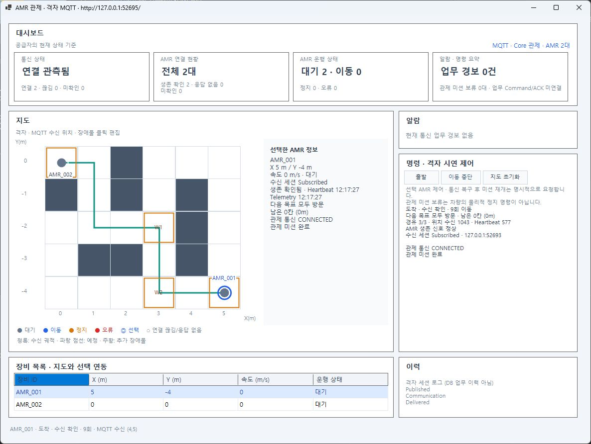
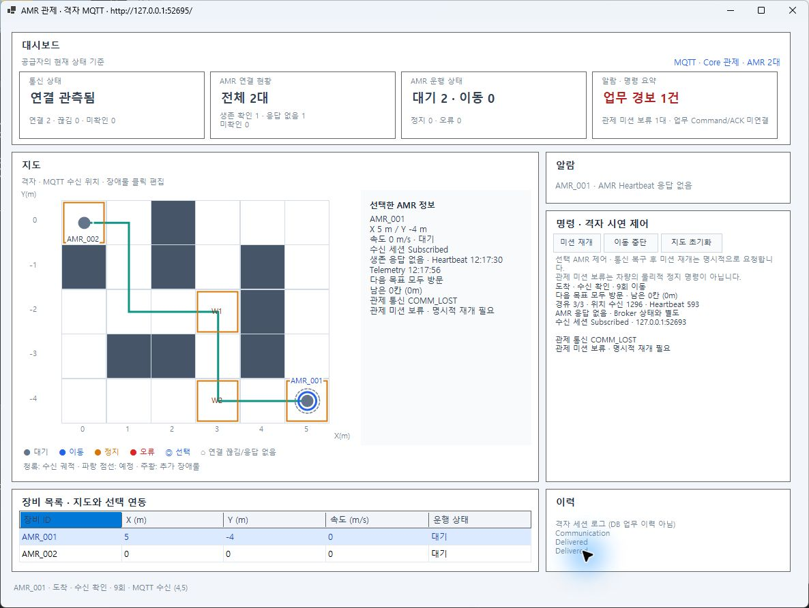
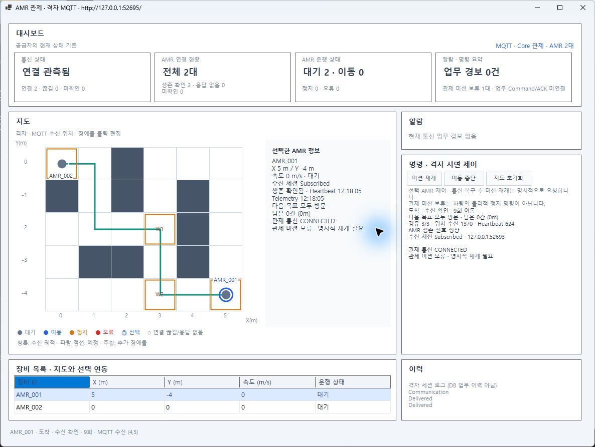
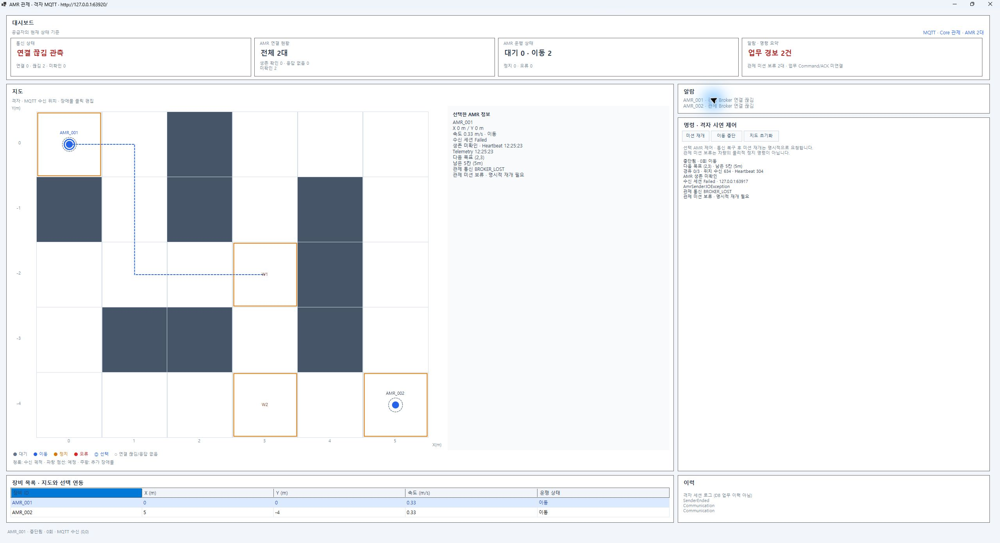

# 두 AMR 독립 감시·Core 도메인·GUI 검증

- 실행 ID `20261028-two-amr-domain-01`, 2026-10-28 Asia/Seoul. HEAD `4e44fa880cb0d1fcccb000dbc53e634fd90381b5` + 미커밋 변경, `feature/46-grid-map-integration` 유지. [최종 소스 해시](final-source.json) · [기계 판정](verification.json) · [보존 감사](final-audit.json).
- 사용자 요청: 기존 AMR별 독립 큐를 재사용해 두 대를 감시하고 **통신 관측 이벤트 → Core AMR 도메인 관리자 → 조회 상태/업무 경보 → GUI**로 확장.
- 사용자 선택: 무응답 시 해당 관제 미션을 보류하고 경보 표시. 통신 복구로 경보는 해제하지만 미션은 자동 재개하지 않는다. 차량의 물리적 정지·교통 락·DB·차량 측 역방향 Watchdog은 이번 범위가 아니다.
- 기준: 과제1 COM02-A·기존 DN-09/10 큐/감시 계약, 과제4 CORE-01/02 일부·관제 통신 업무 경보·시연 미션 정책, 과제3 조회/표시 계약. 원본 과제1/3/4 계획의 `two-amr-domain-20261028`에 착수 범위와 결과를 연결한다. 기존 계약의 첫 정상 Heartbeat 등록·Timeout5초/확인500ms·단조 시각·중단당1회/복구1회는 유지했다.
- 환경: Windows, SDK10.0.401/net10.0, Windows Forms net10.0-windows, MQTTnet5.2.0.1603, Mosquitto2.1.2-alpine. 기존 패키지 버전을 사용한 Core 시험 프로젝트만 추가했다.

## 구현과 책임

| 위치 | 역할 |
| --- | --- |
| [ControlCommunicationSession](../../../src/Amr.Communication/Mqtt/Sessions/ControlCommunicationSession.cs) | 한 Broker 수신 연결, 기존 AMR별 큐, ID별 감시기. 타이머·수신 시각·종료/연결 정리를 소유. 기존 단일 ID 생성자/관측 속성 유지 |
| [AmrCommunicationObservation](../../../src/Amr.Communication/Mqtt/Sessions/AmrCommunicationObservation.cs) | 세션 ID·순번·AMR ID·관측 상태의 형식화 통지. 통신 계층은 미션을 모름 |
| [FleetCommunicationBridge](../../../tools/Amr.Simulator.Map/Control/FleetCommunicationBridge.cs) | 조립 계층에서 통신 DTO를 Core 입력으로 변환. Core에 MQTT 참조를 추가하지 않음 |
| [AmrDomainManager](../../../src/Amr.Core/AmrDomainManager.cs), [입력/조회 모델](../../../src/Amr.Core/AmrDomainModels.cs) | 등록된 두 ID의 최신 상태, `COMM_LOST`/`BROKER_LOST`, 관제 미션 보류·명시 재개·업무 경보. MQTT·Timer·Windows Forms 의존 없음 |
| [FleetMapSession](../../../tools/Amr.Simulator.Map/Control/FleetMapSession.cs), [FleetMapHost](../../../tools/Amr.Simulator.Map/Control/FleetMapHost.cs) | 두 Simulator·통신·Core 조립과 HTTP 제공. 기존 단일 호스트는 유지. 각 수신/송신 Client의 ClientId를 별도로 소유 |
| [GridMapDataProvider](../../../src/Amr.ControlGui/GridMapDataProvider.cs), [MainForm.Grid](../../../src/Amr.ControlGui/MainForm.Grid.cs) | Fleet 경로에서는 Core 스냅샷으로 요약·선택 상세·업무 경보를 표시. raw Heartbeat로 생존을 재판정하지 않음. 기존 단일 경로 호환 유지 |

정상 Heartbeat 관측은 큐 접수 전 갱신하고, Telemetry 등 메시지는 기존 ID별 큐로 전달한다. 한 AMR의 느린 수신 처리가 다른 AMR의 소비 작업이나 두 감시기의 수신 시각 갱신을 막지 않는다. 단조 시각 갱신/검사/형식화 통지는 세션에서 직렬화하고 Core는 세션 ID·AMR별 순번으로 이전/중복 관측을 배제한다. Core의 짧은 상태 갱신 잠금에는 네트워크 I/O가 없다.

복구 후에도 `OnHold`를 유지한다. 보류 중 실제 최종 Telemetry가 수신되면 완료 관측을 고정하고 명시적 재개 시 관제 완료로 반영한다. Telemetry의 IDLE/BUSY·위치·속도를 임의로 FAULT/STOPPED로 바꾸지 않는다. Broker 단절에는 두 감시가 중지되고, 마지막 정상 Heartbeat/Telemetry를 Core 조회에 보존하며 시연 제어 API도 거부한다.

## 시험 입력·예상·실제·판정

| 시험 | 입력/예상 | 실제·근거 |
| --- | --- | --- |
| 솔루션 빌드 | 기존+신규 프로젝트 빌드0경고/0오류 | 통과, [build-verified.log](build-verified.log) |
| 자동 회귀 | 기존1116 + 신규25 | **1141/1141 통과**, 통신805·Core9·GUI53·Map72·Simulator202. [5개 TRX 요약](test-summary.json) · [표준 VSTest 출력](tests-verified.log). 앞선/개별 실행과 중복 합산 안 함 |
| 두 AMR 정상 | 동일 Broker, A1/A2 Ready에서도 Heartbeat 증가, 각 미션 시작 | 통과, [최종 정상/출발](../20261028-two-amr-verified/01-two-alive-running.json) |
| A1 Heartbeat만 중단 | Telemetry 유지, A1무응답/관제 미션 보류·경보1, A2정상·미션 영향 없음 | 통과, [최초 Timeout/격리](../20261028-two-amr-verified/02-a1-timeout-a2-alive.json). 불량 A1/미등록 OTHER 입력과 Telemetry로 생존 복구 안 됨 |
| A1 Heartbeat 재개 | A1생존 복구·경보 해제, 관제 미션 보류 유지 | 통과, [복구 후 보류](../20261028-two-amr-verified/03-recovered-still-held.json) |
| 명시적 재개 | 지정 AMR의 미션만 Running 또는 완료 관측 반영 | 통과, [재개 요청 전/후](../20261028-two-amr-verified/04-explicit-resume.json) |
| A1 수신 처리 지연 | A1 큐 처리 건수 정체, A2 처리 증가. A1의 큐 앞 Heartbeat 관측은 계속 갱신 | 통과, [두 큐·Core 시각 비교](../20261028-two-amr-verified/05-independent-queues.json) |
| Broker 중단 | 두 감시 Stopped·Core BROKER_LOST·두 활성 미션 OnHold·경보2. 5.5초 뒤 추가 AMR Timeout 없음 | 통과, [단절 전/직후/추가 관찰](../20261028-two-amr-verified/06-broker-loss-both-stopped.json). 단절 뒤 cancel/reset 거부와 보류 유지도 확인 |
| 실제 Windows Forms | 정상2/무응답1+정상1/복구 후 보류/단절2·보류2·경보2 | 아래 화면·AX. 최종 단절 화면은 최종 실행 파일 사용. 앞선 정상/무응답/복구 화면은 live-02 시점이며 마지막 수신 시각 보존/단절 제어 거부/생존 문구의 Core 우선 보완 전 실행과 구분 |
| 기존 단일 AMR | 현재 통신 코드로 기존 9/15회 경유·우회·수신 좌표·Broker 단절15항목 | [15항목 통과](../../AMR/20261028-two-amr-legacy-check/verification.json), [출력](legacy-check.log), [정리](../../AMR/20261028-two-amr-legacy-host/cleanup.json) |
| 기존 Mock/F5 | Mock 회귀, 원래 F5/Map 프로필 유지 | GUI53건에 Mock 포함. 기존 첫 프로필과 Grid MQTT 설정의 구조 동등성을 [감사](final-audit.json)에서 확인. **이번 새 Fleet 프로필의 네이티브 F5 입력은 미실행**. 기존10/27·앞선10/28 실제 F5 근거를 이번 재실행으로 합산하지 않음 |






GUI의 선택/서버 요청 ID·경보·재개 버튼과 raw 관측이 Core 조회를 덮어쓰지 않는 조건은 `FleetDashboardTests`에서 확인했다. 실제 시연에서 미션 재개는 시험 API 입력이며 네이티브 버튼 클릭으로 성공한 것으로 집계하지 않는다. 최종 GUI들은 소유 PID/시작 시각/실행 경로를 확인한 프로세스 정리로 종료했으며 **이번 정상 창 닫힘 검증으로 집계하지 않는다**. 호스트/통신 세션의 정상 종료와 구분한다.

## 보존·복구·정리

[감사](final-audit.json): 기존3263파일 중 **3250 동일·승인 대상13변경**, 모든 기존 시험 증거·원래 미추적50·보존 bundle/ZIP·stash·보존 브랜치 유지. 기존 `AmrReceiveQueue`·감시기·Simulator·Core 공유 계약·Mock 소스·GUI/Map 기본 설정은 유지했다. 이전 소스187파일은 [before-source.zip](before-source.zip)의 모든 엔트리를 착수 SHA256과 비교해 복구 가능 확인.

원래 `AMR Grid + GUI`/`Grid MQTT` 프로필의 내용은 같고 새 `AMR Fleet + GUI`/`Fleet MQTT`를 추가했다. 기본 GUI Mock과 단일 AMR 설정 파일은 불변이다. 현재 HEAD/브랜치/origin·stash/보존 참조 불변, 스테이징0, 커밋·푸시·PR·병합 없음.

[기존7컨테이너](containers-before.jsonl)와 [정리 후](containers-after.jsonl)의 ID/상태가 같고, 새 시험 컨테이너는 전부 제거했다. [프로세스 정리 후](processes-after.json)는 기존 VS만 남았다. 사용하지 않은 `two-amr-live-final` 준비 세션은 최종 검증 세션으로 교체한 뒤 정상 종료했다. 해당 중간 세션의 기준선에는 다른 소유 시험 컨테이너가 포함돼 있어 전체 보존 판정은 작업 시작의 기준선을 사용한다.

## 실패·수정·미검증

- 첫 실제 연결에서 수신 Client와 A1 송신이 같은 설정 객체의 ClientId를 공유해 수신이 BrokerDisconnected로 종료됐다. 수신 연결에 별도 설정/고유 ClientId를 할당한 뒤 최종 세 Client 연결이 정상 유지됐다. `two-amr-live-01`, [첫 실패 상태/로그](live-healthy.log), [당시 Broker 기록](first-broker-client-collision.log) 보존.
- 초기 전체 회귀에서 GUI 최소 창 시험1건이10초 제한으로 실패했다(`tests-01.log`). 같은 기대/제한을 유지하고 GUI 단독53건 및 최종 전체1141건에서 통과했다. 제한 시간을 늘리거나 시험을 생략하지 않았다.
- Probe의 IDisposable 누락, 새 설정 시험의 raw 문자열 중괄호 오류와 GUI nullable 경고를 수정했다. `build-02/04`·`build-probe` 등 이전 기록은 보존하고 최종0경고/0오류로 확인했다.
- live-02 Broker 시험에서는 OnHold 관측 뒤 Canceled 상태가 조회됐다([실패 상태](broker-down-first-failure-state.json)). 단절 뒤에도 cancel/reset이 허용되어 보류를 덮을 수 있는 경로를 확인해 서버/GUI에서 차단했다. 당시 요청 주체는 기록이 없어 단정하지 않는다. 최종 실행은 [제어 요청 추적](../20261028-two-amr-verified/control-requests.jsonl)과 단절 뒤 명시적 거부 시험으로 확인했다.
- 제한 환경의 프로세스 조회에는 외부 GUI가 보이지 않아 재실행한 경우가 있다. 허용된 CIM 조회로 실제 PID를 확인하고 중복 시험 창도 모두 정리했다. 창 최소화/입력 보호 때문에 네이티브 F5 재검증은 하지 않았고 구성 대조와 CLI 실연동을 구분했다.
- 실제 차량·안전 정지/Watchdog·교통 노드 락/충돌 방지·DB 영속화·전체 업무 미션 배정/회수·Command/ACK·자동 재접속·대규모/장시간 운용은 미구현/미검증이다. 이번 관제 미션은 메모리 기반 시연 정책이다.

## 설계 선택·대안·예상 PR 질문

한 Broker 수신 세션에서 ID별 감시기와 기존 큐를 공유했다. 기존 큐를 중복 구현하거나 AMR마다 전용 스레드를 만들지 않는다. 통신은 관측을 발행하고, Core가 업무 정책을 처리하며, 기존 호스트가 형식을 변환한다. 별도 Infrastructure 프로젝트는 이번에 만들지 않았다.

| 대안 | 장단점·재검토 조건 |
| --- | --- |
| AMR마다 MQTT 수신 Client/세션 생성 | 연결별 독립 수명은 간단하지만 Broker 연결·타이머/구독 수가 장비 수에 비례하고 중복 수신 필터가 늘어남. 독립 Broker/자격증명/격리 요구가 생길 때 검토 |
| Core가 수신 시각을 주기 검사 | 연결 수명·타이머 책임이 도메인으로 넘어가 사용자 요구와 어긋남. 이번에는 채택하지 않음 |
| 별도 Infrastructure/독립 관제 프로세스 | 호스팅/다른 Transport/DB 연결을 확장하기 좋지만 현재 두 장비에서는 프로젝트·수명 조립이 늘어남. 운영 실행 주체·DB/Transport 교체 요구가 생기면 어댑터를 옮길 수 있음 |

1. **독립 큐인데 Core에는 왜 짧은 공유 잠금이 있는가?** 두 장비의 조회 스냅샷·경보·미션 상태를 일관되게 복사하기 위한 메모리 갱신 구간이다. I/O나 대기 작업은 넣지 않는다. A1의 비동기 처리 지연 중 A2 진행을 자동·실제 시험으로 확인했으며 처리량 성능 시험을 한 것은 아니다.
2. **왜 통신 복구가 미션을 재개하지 않는가?** 사용자가 선택한 정책이다. Core가 OnHold를 유지하고 명시적 재개를 검사한다. 물리적 이동은 Telemetry 그대로이며 관제 보류를 STOP 명령으로 표현하지 않는다.
3. **AMR 장애 격리를 어디까지 보장하는가?** Heartbeat 상태·큐 처리 순서·일반 지연은 ID별이다. Broker 연결/수신 세션의 치명 오류는 두 장비에 공통 영향을 준다. 프로세스 내부 큐는 MQTT QoS0의 종단 간 순서/중복/유실이나 분산 exactly-once를 보장하지 않는다.

## 재현

원본 과제1 v0.56·과제3 v0.15·과제4 v0.9, 결정사항 v0.17·기능명세 v0.14·전체일정 v0.54와 같은 날짜 일일업무를 갱신했다. [문서/보기본 해시](documents-after-finalization.json), [6개 양식 검사·보기본1/3/4 갱신](documents-verification.json), [문서 연결218개/검증 소스204개 대조](final-document-source-check.json)를 확인했다. 이 검사는 제품 시험과 별도로 집계한다.

일반 실행은 [BUILDING](../../../BUILDING.md)과 설정 파일을 따른다. 새 F5 프로필은 구성 검증만 했으며 실제 입력 검증은 위 한계를 따른다.

```powershell
dotnet build AmrControlSystem.slnx -c Release -p:OutputPath=bin/TwoAmrFinal2/
dotnet test AmrControlSystem.slnx -c Release -p:OutputPath=bin/TwoAmrFinal2/ --no-build --no-restore
dotnet build tests/manual/COM02-A/FleetProbe -c Release -p:OutputPath=bin/TwoAmrFinal2/
pwsh -NoProfile -File tests/manual/COM02-A/Verify-TwoAmr.ps1 -Phase Launch -RunId new-two-amr-run -ProbeExe tests/manual/COM02-A/FleetProbe/bin/TwoAmrFinal2/FleetProbe.exe
# 같은 RunId로 Healthy → Timeout → Recovery → Resume → SlowQueue → BrokerDown → Cleanup을 실행한다.
```

실제 MQTT/Docker·로컬 소켓이 허용된 환경에서 매번 새 RunId를 사용한다. 장애 주입/처리 지연은 시험용 Probe에만 있고 제품 GUI에는 추가하지 않았다. 실행 증거를 덮어쓰지 않는다.


## 2026-11-01 보관 위치 정리

이 실행의 정상 중간 결과/일회성 도구 12개는 [정리 목록](../../curation/20261101.json)에 원래 경로·해시·고정 Git 링크를 기록하고 작업 폴더에서 제외했다. 당시 수치·실패/미검증 판정은 원문 그대로이며 원본 전체는 [정리 전 고정 버전](https://github.com/inhhlee/amr-control-system-demo/tree/ae71f452f27a65ec2fee68fee60496a7a5ca3d6c/evidence/COM-02/20261028-two-amr-domain-01)에서 확인한다. 과거 manifest의 파일 목록·해시는 당시 스냅샷이며 현재 폴더 전체 검사 입력으로 사용하지 않는다. 당시 도구를 재현할 때는 해당 고정 버전의 자료를 사용한다.
