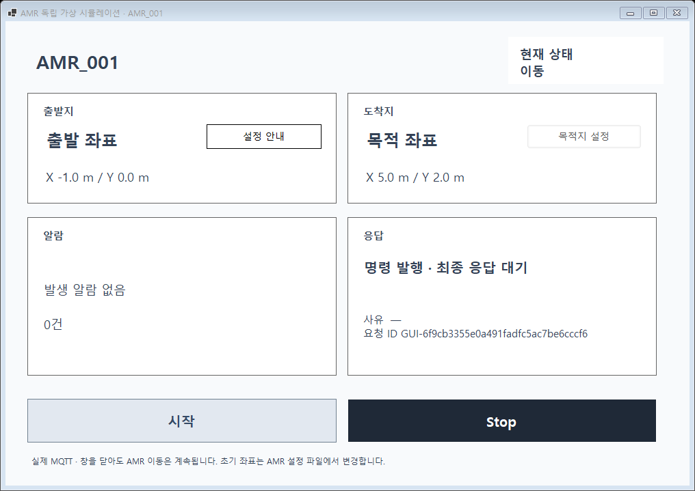
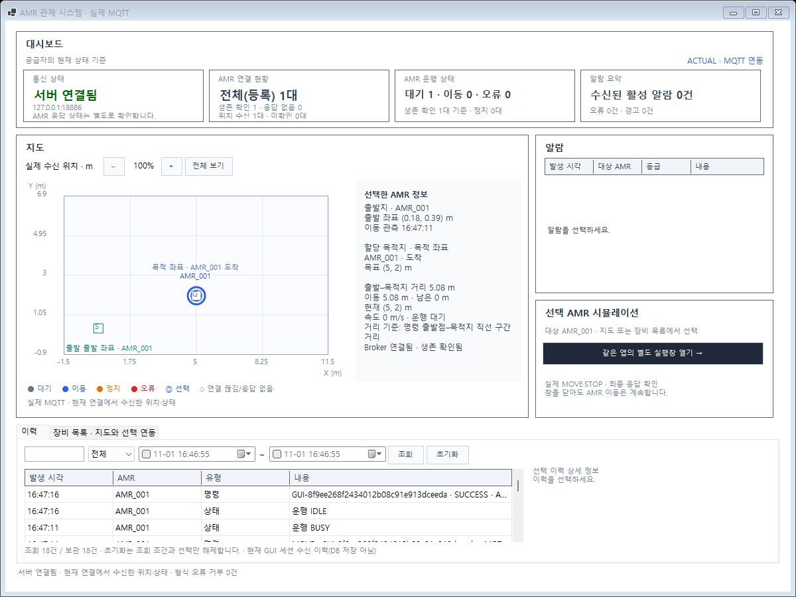

# Figma 구성의 실제 GUI·MOVE/STOP 연결 검증 (#58·#51 일부)

## 1. 배경·목적·완료 범위

관제 화면에서 실제 가상 AMR의 위치·상태를 확인하고, 같은 대상의 별도 창에서 이동·정지를 요청한 뒤 실제 수행 결과를 확인하도록 연결했다. 콘솔 UI를 포함하는 대신 trial이 쓰는 공통 통신 모듈을 재사용한다.

- 입력: 지정한 실제 AMR ID, 설정 파일의 초기 좌표·속도·마지막 목적지, 화면의 목적지/MOVE/STOP, 실제 MQTT Telemetry·Heartbeat·Alarm·ACK.
- 출력: 실제 등록/연결 집계, 지도와 출발·현재·목적지/거리, 알람과 세션 이력, 발행/최종 수행 결과, 단절/재접속 상태.
- 결과물: 최신 Windows Forms GUI + 실제 공급자 + Core 명령 추적 + 독립 Simulator 명령 대기 실행. **로컬 구현·시험 완료이며 커밋·푸시·PR·병합은 하지 않았다.**
- 적용 기준: 기능명세 v0.13 GUI-01~05·CORE-04·AMR-04, 공통데이터 v0.12, 공통규칙 v0.12, 결정사항 v0.16 및 2026-11-01 후속 기록. 원본은 `C:\process-plan`의 해당 문서다. MQTT Topic/Payload·최종 ACK 계약은 유지한다.
- Figma `ZyTPFPyj2CGcYygMxBGajo`, 관제140:2/별도 창145:618. 추출 도구 호출 제한으로 **사용자 승인한 기존 확인 화면·첨부 검토 기준·기존 코드**를 사용했다. 정밀 추출·픽셀 일치 검증으로 표시하지 않는다.

## 2. 진행 내용과 필요한 이유

| 변경 | 목적과 동작 | 주요 코드 |
| --- | --- | --- |
| 실제 공급자 연결 | 등록된 실제 대상과 수신값만 표시한다. 수신 전 좌표·예시 AMR/알람을 만들지 않는다. | `MqttAmrDataProvider`, `MainForm.Mqtt.cs` |
| 지도·별도 창 | 같은 대상의 출발/현재/목적지, 속도·상태·응답을 함께 확인한다. 거리 확대/축소는 좌표를 변경하지 않는다. | `MainForm.Feedback.cs`, `SimulationForm` |
| 목적지와 초기 좌표 구분 | 목적지는 화면에서 정하되 초기 좌표는 AMR 설정 파일에서 변경한다. 실제 좌표를 순간 변경하는 명령을 만들지 않는다. | `DestinationSelectionForm`, `IAmrMissionPlanner` |
| 명령 ID·최종 결과 추적 | 발행 전에 기록하고 AMR/요청 ID를 대조한다. MQTT 발행 반환을 도착 완료로 표시하지 않는다. | Core `CommandTracker`, 실제 공급자의 `ICommandDispatcher` |
| 실제 MOVE/STOP | 독립 AMR이 명령을 수행한다. 중단 MOVE는 FAILURE, 별도 STOP은 SUCCESS다. 다시 시작하면 멈춘 위치부터 새 MOVE ID를 쓴다. | `CommandDrivenAmr`, `MqttCommandSimulationSession` |
| 수명·재접속 분리 | 별도 창을 닫아도 이동은 계속한다. GUI 종료는 자기 통신을 정리하고, 이미 발행한 명령을 자동 재전송하지 않는다. | `SimulationForm`, `Program`, 공통 재접속 세션 |
| 실제 알람·세션 이력 | 수신한 알람의 발생/해제와 명령/통신 이력을 확인한다. 조회 초기화는 기록을 삭제하지 않는다. | 실제 공급자, `RefreshFeedback`, `ResetHistoryView` |

명령 발행은 같은 공급자 내 접수 순서대로 한 번씩 수행한다. 접수 시 연결 세션 ID를 보존해 구연결의 미발행 요청을 새 연결에 넘기지 않는다. 이 직렬 처리가 여러 프로세스 사이의 순서·중복·유실 방지를 보장하는 것은 아니다. QoS0·retain=false이며 재전송/영속 저장은 추가하지 않았다.

AMR 실행 루프 한 곳에서 시간 갱신·명령 수행·최종 ACK를 처리한다. MQTT 콜백은 검사/유한 큐 접수만 맡는다. 중복 요청은 이동을 재실행하지 않고 기존 결과를 사용하며, 같은 ID의 다른 내용은 기존 요청을 훼손하지 않는다. 큐 초과 시 실행 실패로 종료하고 자동 복구로 숨기지 않는다.

거리 표시는 현재 직선 구간 기준이다. 아직 명령을 실행하지 않은 계획의 이동·남은 거리는 `null`/미확인으로 표시한다. 재접속 뒤 다른 대기 좌표가 오면 과거 완료 미션을 현재 도착으로 표시하지 않는다.

## 3. 코드·환경·확인 방법

- 실행 ID: `20261101-figma-live-02`, 최종 실제 실행 `live-final-03`.
- Git 기준: `755e1405dd4bb74b54a80a97abdc47d244fcfd99` + `feature/58-gui-mqtt-live` 미커밋 변경. 기존 #58 변경을 이어서 작업했다. 최종 코드·빌드 DLL/입력/명세 해시는 [검증 목록](verification.json)으로 식별한다.
- Windows 10.0.26200, .NET SDK10.0.401/런타임10.0.12, MQTTnet5.2.0.1603, Docker Mosquitto2.1.2-alpine. 실제 관측은 [환경 기록](environment.log)과 실제 결과 JSON에 남겼다.
- 실제 시험은 독립 AMR 프로세스, 실제 Windows Forms, 고유 이름의 임시 Broker `127.0.0.1:18886`을 사용했다. 기존 개발 Broker1884와 구분한다. 종료 때 시험 소유 컨테이너/AMR만 정리한다.
- [직접 실행 명령·단절 재현·시험 도구](../../../tests/manual/GUI-CONTROL/README.md). GUI 화면 시험은 같은 데스크톱에서 다른 화면 시험과 겹치지 않게 실행한다.

| 시험 | 입력 → 예상 결과 | 이번 최종 실제 결과·근거 |
| --- | --- | --- |
| Core 자동 | 빠른/중복/충돌/다른 ID·늦은 ACK, 기한 경과, 한도·확인된 Stop → 기존 결과 보존/정확한 대조 | [16/16](core-final.trx) |
| Simulator 자동 | 이동·도착·중단·새 MOVE·중복/충돌 요청 → 최종 결과/좌표 보존 | [250/250](simulator-final.trx) |
| 통신 자동 | 기존 세션 회귀·구세션 명령 발행 → 구세션 요청이 새 연결로 넘어가지 않음 | [827/827](communication-final.trx) |
| GUI·실제 공급자 자동 | 표시/수명/버튼/목적지 배치, 실제 공급자에 Fake MQTT 입력 → 요청·수신·연결/이력 반영 | [84/84](gui-final-03.trx) |
| 지도 도구 회귀 | 기존 격자/도메인 시험 → 기존 동작 유지 | [72/72](map-final.trx) |
| 전체 빌드 | 솔루션 Debug 빌드 → 경고/오류 없음 | [경고0·오류0](build-final-03.log) |
| 실제 GUI·MQTT | 아래 20항목 → 실제 이동/수신/응답/재접속 확인 | [20/20](live-final-03/control-results.json), [실행 출력](live-final-03-run.log) |

자동 시험 **1,249건**과 실제 GUI/MQTT **20항목**은 서로 구분한다. 이전 실행 결과를 새 실행에 합산하지 않았다. SQLite·장시간/대량·실제 물리 AMR·운영 안전 정지를 시험한 것은 아니다.

실제 시험: CTRL-01~03 실제 등록·초기 좌표·설정 표시, 03A 목적지 입력(잘못된 NaN 거부/정상 적용), 04~07 MOVE·STOP·좌표 유지·새 ID 재출발, 08~10 창 닫기/재열기·도착/ACK·거리, 11 알람 발생/해제 수신, 12~13 이력 조회/초기화 보존, 14~15 중복/상충 ACK, 16~18 단절·재접속·새 위치 전 미확인·자동 재전송 없음, 19 GUI 전체 종료 뒤 독립 AMR의 도착 ACK를 별도 관찰자가 수신.

알람·중복/상충 ACK는 시험 도구가 실제 MQTT로 발행한 입력이다. Simulator의 장애 시나리오 구현으로 계산하지 않는다. [입력 설정](live-final-03/simulator-control.config.json), [관제 통신](live-final-03/communication.jsonl), [단절 전 AMR](live-final-03/simulator-before.log), [재실행 AMR](live-final-03/simulator-after.log).

## 4. 대표 화면

목적지 설정 버튼·실제 요청 ID와 최종 응답 대기를 확인한다.

실제 AMR 한 대의 도착·지도·거리·세션 이력을 확인한다.

[정지 화면](live-final-03/02-stopped-window.png) · [도착 응답](live-final-03/04-arrived-window.png) · [연결 끊김](live-final-03/05-disconnected-dashboard.png).

## 5. 발견 사항·수정·재확인

- 새 공급자 시험은 재접속 전의 대기 스냅샷을 현재 연결로 오인해 1건 실패했다. [첫 실패](gui-control.trx), [후속 실패](gui-control-02.trx)를 보존했다. 실제 `Reconnected` 이벤트와 새 Telemetry를 기다리도록 시험 동기화를 수정했고 [해당3건 재확인](gui-control-03.trx)과 최종84건이 통과했다. 제품의 재접속 결과로 실패를 감추지 않았다.
- 실제 화면 검토에서 목적지 설정 버튼이 Dock 컨트롤에 가려지는 문제를 발견했다. 2열 배치로 수정하고 버튼 노출/경계·실제 모달 입력 시험을 추가했다. [이전 화면](live-01/01-moving-window.png)과 최종 화면을 함께 보존했다.
- [동시 실행 시 GUI 시험](gui-final.trx)은 화면2건에서 15초 제한을 초과했다(82통과/2실패). 다른 시험과 겹치지 않게 실행한 [84건](gui-final-isolated.trx), 마지막 문구 수정 후 [84건](gui-final-03.trx)이 통과했다. 원래 제한·검사 조건을 완화하지 않았다. OS 내부 원인은 확정하지 못했으며 재현되면 화면 시험 실행 환경과 메시지 처리부터 확인한다.
- `core-first`/`simulator-first`/`gui-first`, `live-01`/`live-final`은 단계별 이전 결과다. 최종 판정은 위 표의 파일을 따른다.
- 문서 원본 과제3의 기존 헤더 충돌과 공식 HTML 생성기의 기존 과제1 양식 불일치는 별도 문서 정리 사항이다. Markdown 보완과 보기본 생성 성공을 혼동하지 않는다.
- 마지막 실행 설정 검토에서 MQTT Live 프로필의 상대 설정 파일 경로를 제거했다. 작업 디렉터리가 달라도 실제 연결을 열고 GUI에서 목적지를 정할 수 있도록 했다. 이 JSON·안내 수정은 시험된 제품 바이너리 변경이 아니며 Visual Studio F5 조작은 미실행이다.

## 6. 설계 판단·남은 작업

**선택 이유:** 현재 한 대 시험에 기존 DataProvider/Dispatcher와 trial 세션을 재사용하고, Core의 명령 기록을 MQTT·폼 수명과 분리했다. 독립 AMR이 이동을 소유하므로 창을 닫아도 이동이 끊기지 않는다. 유한 메모리 한도에서 기존 근거를 자동 삭제하지 않고 수집/접수를 제한한다. 명령128(Stop 한 자리 예약), 알람코드256, 이력2048은 실습 한도이며 운영 보존 정책이 아니다.

**현실적인 대안:** GUI 내부 Mock 이동은 실행이 간단하지만 실제 통신·독립 프로세스 동작을 증명하지 못한다. 요청/이력을 DB에 영속 저장하면 재시작 복원에 유리하지만 저장 실패·재처리·정리 정책과 추가 검증이 필요해 이번에는 메모리에 제한했다. 여러 AMR·대량 이력이 필요하면 장비별 처리/조회·저장 구조를 다시 검토한다. 성능 우열을 측정한 비교가 아니다.

예상 검토 질문:

1. **발행 성공인데 왜 완료가 아닌가?** QoS0 발행 반환은 AMR 동작의 증거가 아니다. Core가 등록한 AMR/요청 ID의 최종 ACK와 실제 좌표·상태를 별도로 확인한다.
2. **단절 뒤 명령을 다시 보내는가?** 자동으로 보내지 않는다. 구세션의 미발행 요청은 새 세션에서 거부한다. 결과 미확인 MOVE는 그대로 보존하며 수동 Stop의 최종 성공을 확인한 뒤 새 MOVE를 시작할 수 있다. 이 규칙이 물리 장비 안전을 보장하는 것은 아니다.
3. **과제2~5가 모두 끝났는가?** 아니다. 실제 MOVE/STOP과 GUI 연결의 제한된 범위다. RESET/FAULT 복구·장애 시나리오 #50, 여러 AMR 제어, DB 이력과 전체 통합 검증, 운영 정책은 남았다.

현재 Simulator는 Broker 단절 시 종료하며 자동 재접속하지 않는다. 실제 시험에서도 Broker 복구 후 AMR을 다시 실행했다. 마지막 시험 프로세스 정리는 도구가 소유한 프로세스를 종료한 것이며 Ctrl+C 정상 종료 검증으로 집계하지 않았다. 커밋·원격 게시·Issue 종료·PR은 수행하지 않았다.
