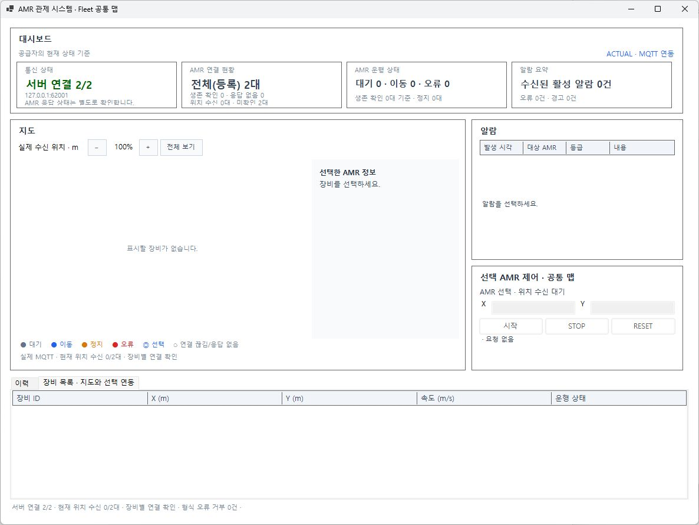
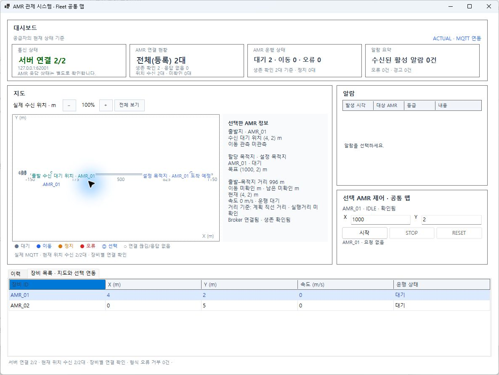
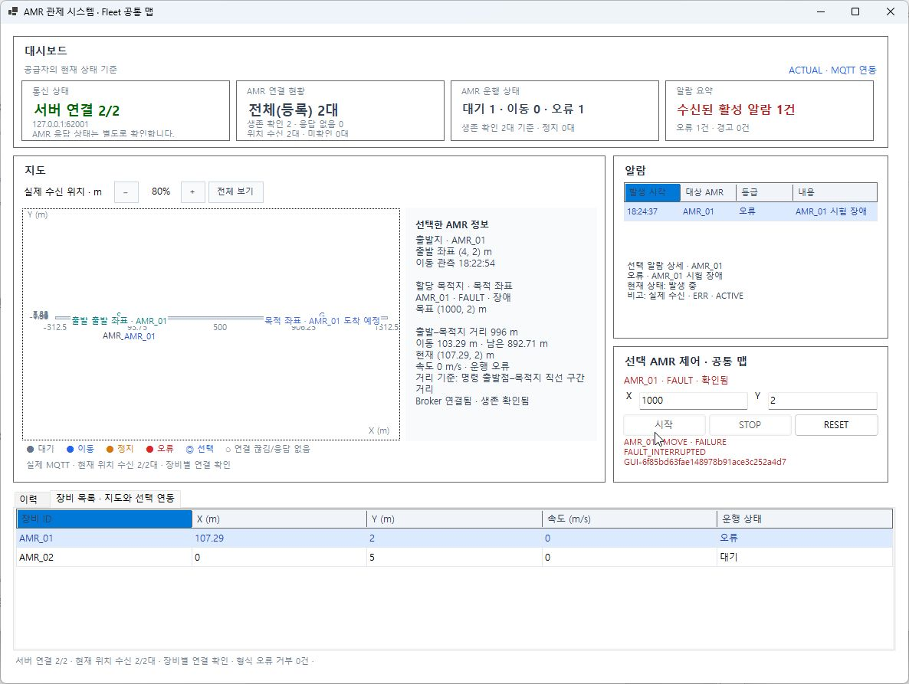

# GUI-01~05 · CORE-04 Fleet 공통 맵 구현·검증

- 실행 ID: 20261102-fleet-map-01, 2026-11-02 KST.
- 코드: feature/50-fault-reset, HEAD `4aa0b8a3ba4941b872f30ce1619b18d106023daa` + 기존/이번 미커밋 변경. 커밋·푸시·PR·병합 없음.
- 기준: 사용자의 이번 7개 완료조건, 공통규칙 v0.13·데이터 v0.13·기능 v0.15·결정 v0.18의 기존 MQTT/RESET 의미. 이번 추가 GUI 계약은 원본 문서의 `fleet-common-map-20261102`에 연결.
- 현재 판정: **구현·자동시험 통과, 실제 GUI 전체 완료조건은 검증 중**. 사용자가 직접 조작을 선택하여 자동 UI 입력을 멈췄다. 지도 보완 버전의 창 교체도 아직 수행하지 않았다.

위 버전·미게시 표시는 시험 당시 기록이다. 이후 GitHub 게시 대상과 추가 RESET 송신 관찰은 [게시 점검 기록](../../GIT/20261102-fleet-publication-01/README.md)을 따른다. 아래 명령9건/ACK9건 집계는 기존 MQTT 관찰 구간만 포함한다.

## 변경과 선택 이유

기존 GUI는 한 공급자/한 AMR이었고 Fleet 엔진과 MapCanvas는 여러 AMR을 지원했다. 새 `FleetMqttAmrDataProvider`가 단일 공급자를 장비별로 소유하고 전체 스냅샷으로 집계한다. 장비별 목적지·명령·연결·생존·알람을 재사용하며 Simulator 실행 엔진은 변경하지 않았다.

- Program/MqttGuiOptions: `--fleet-config`, 단일 옵션 충돌/설정 검사, 수신 전 위치 미생성, 프로그램 소유 종료.
- AmrChange: `DeviceConnections` 추가. 전체 Connection 요약과 대상별 신선도/연결을 구분.
- MainForm.Fleet: 같은 창에 대상 X/Y·시작·STOP·RESET·최종 응답. 클릭 시 ID/좌표 고정, 장비별 입력 초안/명령 ID/거부 사유 보존.
- MainForm/Mqtt/Feedback: 전체 스냅샷을 기존 목록 교체 방식에 연결. 장비별 연결로 제어/마지막 수신 여부 판단. 기존 InvokeAsync 경계 유지.
- MapCanvas: 실제 화면에서 먼 목적지로 지도 Plot이 가늘어져 마커가 잘리는 문제 발견. 짧은 축의 세계 범위를 확장해 전체 표시 면적과 같은 X/Y 배율을 유지. 기존 극단 좌표 거부 조건 보존.

실행 예제와 조작 순서는 [FLEET-GUI Runbook](../../../tests/manual/FLEET-GUI/README.md)에 둔다.

## 실제 환경

| 항목 | 값 |
| --- | --- |
| OS/SDK | Windows, .NET SDK10.0.401, net10.0-windows, MQTTnet5.2.0.1603 |
| 자동시험 구성 | FleetEngine 초기, 지도 보완은 FleetGui(사용 중인 GUI DLL 보존) |
| 실제 Broker | Docker Mosquitto2.1.2, 127.0.0.1:62001, 소유 컨테이너는 live/owned.json |
| 실제 프로세스 | 독립 Simulator EXE + GUI EXE 하나. GUI PID41264, Simulator PID/시각은 owned.json |
| 시험 입력 | live/fleet.json, AMR_01/02 command모드, 장애180초/원인 해소360초, 목적지1000m, GUI 결과 대기900초 |
| MQTT 관찰 | 별도 mosquitto_sub amr/#, QoS0/Retain=false. 기존1884 Broker와 Seq5341 보존 |
| 소유 세션 | 사용자 조작 중인 시험 GUI·Simulator·Broker는 유지. 정리 완료로 표시하지 않음 |

## 자동시험

| 실행 | 실제 결과 | 근거 |
| --- | --- | --- |
| 최초 GUI | 91통과. 새 시험 파일이 기존 격자 Fleet 시험 이름과 겹친 것을 감사에서 발견 | gui-first.trx / gui-final.trx |
| 지도 수정 첫 회귀 | 91통과/1실패. 극단 범위의 기존 거부 조건이 변경되어 수정 | gui-map-final.trx |
| 지도 보완 | 92통과 | gui-map-corrected.trx |
| **전체 GUI 최종** | **96통과/0실패**, 기존 격자 시험4건 원본 복원 + 새 시험 별도 파일. 기존 파일 SHA256은 작업 전과 일치 | **gui-complete.trx** |
| **Core** | **17통과/0실패** | **core.trx** |

최종 **113건**이며 중간 실행을 합산하지 않는다. 새 자동시험은 전체 스냅샷/Revision, 목적지 격리, 고유 ClientId, 다른 장비 ACK 배제, 같은 알람 코드 분리, RESET 결과, 한 연결 실패 중 다른 장비 제어, 느린 구독 재동기화, 모든 Client/이벤트 종료, 옵션 충돌, 한 맵·선택 입력/늦은 ACK 보존과 마커 잘림을 확인한다.
이전 Simulator271·실제 Fleet8항목은 Simulator 소스를 보존한 기존 근거이며 이번 자동시험 수에 합산하지 않는다.

## 실제 MQTT·GUI 관찰과 남은 시험

GUI18:19:53 시작, 독립 Simulator18:21:37 시작. 초기 GUI는 Broker 연결2/2·등록2대·위치0대를 표시했다. 이후 실제 두 위치·Heartbeat를 받았다. GUI의 AMR_01 시작으로 MOVE를 송신하고 18:24:37 장애 시 원 ID의 실패 ACK/FAULT/속도0/ACTIVE를 받았다. 사용자의 미해소 RESET8건은 모두 FAILURE/FAULT_CAUSE_ACTIVE였다. 18:27:37 원인 해소 이후에도 FAULT/알람 유지가 Simulator 로그에 기록됐다.

실제 수신 명령9건과 ACK9건의 `(AmrId,cmdId)` 일치를 확인했다. [대조표](live/command-ack-audit.json) · [수신 집계](live/observed-summary.json) · [MQTT 원본](live/mqtt.log) · [Simulator 로그](live/simulator.log).

| 완료조건 | 현재 근거/판정 |
| --- | --- |
| ① 한 GUI·한 Map의 두 장비 | 실제 등록/수신/목록2대 확인. 초기 지도에서 먼 목적지의 마커 잘림 발견, 보완 코드 자동시험 통과. **보완 화면 실제 재확인 필요** |
| ② 장비별 다른 MOVE | 자동시험 통과. 실제 GUI에서는01 MOVE만 관찰, 02 조작 대기 |
| ③ 01 STOP과02 이동 지속 | 자동 명령 분리와 기존 Fleet 실행 근거 있음. 이번 실제 GUI 미검증 |
| ④ 01 FAULT와02 이동 지속 | 실제01 FAULT·알람·원 MOVE 실패 확인. 당시02는IDLE. 동시 주행 중 격리는 이번 GUI 미검증 |
| ⑤ RESET 전후/좌표 보존 | 미해소 실패 실제 확인, 해소 후 새 RESET 성공은 사용자 조작 대기. 자동시험 통과 |
| ⑥ 선택 전환 후 늦은 ACK | WinForms 자동시험 통과, 실제 두 장비 조작 미검증 |
| ⑦ GUI 정상 종료/모든 연결 정리 | 자동시험 통과, 사용자 사용 중인 실제 창은 종료하지 않았음 |

위 화면은 지도 보완 **전** FleetEngine 실행이다. 수정된 FleetGui 빌드의 실제 화면으로 오인하지 않는다. 사용자 직접 조작 선택 이후 읽기/로그 관찰만 수행했다. 창 교체 시 GUI 메모리 이력/명령 기록은 새로 시작하고 Simulator 상태는 유지된다. MQTT Alarm은 비보존 메시지이므로 새 GUI에서 기존 ACTIVE를 재수신했다고 간주하지 않는다.

## 검토 질문과 한계

1. 왜 단일 MQTT Client로 바꾸지 않았나? 기존 검증된 재접속·추적·미션 수명을 장비별 재사용하기 위해서다. 장비 증가에 따른 연결/구독·전체 스냅샷 메모리 비용이 있어 규모 시험 후 단일 다중화 세션을 검토할 수 있다.
2. 한 장비 변경으로 다른 마커가 없어지지 않나? 자식 스냅샷을 ID별 캐시에 보존하고 하나의 증가 Revision으로 **전체** Devices/Alarms/Commands를 전달한다. MainForm 목록 교체·개별 조회의 Revision을 일치시켰다.
3. ACK 성공은 전달 보장인가? 정상 연결에서 대상/ID를 대조한 최종 응답 근거다. QoS0 단절·과부하·재시작 중 무손실/정확히 한 번/영속 보장은 추가하지 않았다. GUI 재접속은 기존 기능이며 Simulator 자동 재접속과 다르다.

Broker 상태·장비 생존·운행 FAULT를 구분하며 RESET은 원점 복귀가 아니다. 대규모 Fleet 부하, 교통 제어, 경로 탐색, DB, 과제 전체 완료는 이번 판정 범위 밖이다.
