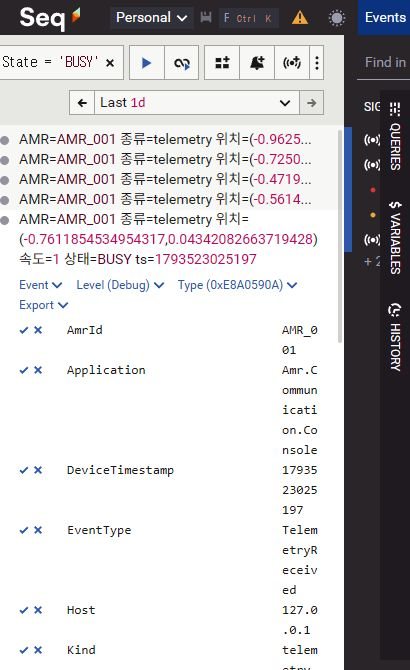

# trial 핵심 콘솔·Docker Seq 상세 조회 검증

## 1. 배경·목적·완료 범위

주기 수신 로그가 콘솔을 채워 명령 시험과 연결 상태 확인이 어려웠다. **콘솔에는 핵심 사건을 남기고, 상세 수신 데이터는 Seq에서 장비·상태·요청 ID로 조회**하도록 사용자 요청을 구현했다. 앞서 만든 입력줄 보호는 유지했다.

- 입력: MQTT의 검사된 Telemetry/Heartbeat/Alarm/ACK, 접속·재접속·큐 관측, trial 명령, Seq 전송 환경 설정.
- 출력: Information 이상 핵심 콘솔, Debug 이상 구조화 Seq 로그, 실행 중 콘솔 상세 전환, 전송 실패/유실 집계.
- 적용: COM-06/05 및 D-10의 2026-11-01 `trial-seq-20261101` 후속. 기존 기능명세v0.13·공통데이터v0.12와 메시지 계약을 유지했다. 담당 원본은 `C:\process-plan`의 과제1 계획·결정사항·같은 날짜 일일업무다.
- 상태: 요청한 로컬 구현·시험 완료. `feature/58-gui-mqtt-live`, HEAD `755e1405dd4bb74b54a80a97abdc47d244fcfd99` + 미커밋 변경. 기존 GUI/Simulator 변경과 증거를 유지했고 커밋·푸시·PR은 하지 않았다.

## 2. 변경과 필요한 이유

| 대상 | 변경·목적 |
| --- | --- |
| `Logging/TrialEventLogger.cs` | 이벤트를 한 번 구조화하고, Serilog 전체 최소 Debug → 입력 보호 Console Sink의 기본 Information / 기존 Seq Sink의 Debug로 나눈다. 같은 RunId·장비·세션·명령을 연결한다. |
| `Logging/SeqLogging.cs`, `StructuredLog.cs` | Seq의 상위 로거도 Debug를 허용한다. 기존 bounded 전송·요청/종료 제한·실패/유실 집계를 그대로 사용한다. |
| trial 표시·명령 루프 | 반복 Telemetry/Heartbeat는 기본 콘솔에서 숨긴다. 첫 수신·상태 변화·재접속 뒤 수신 재개는 남겨 실제 수신 확인이 가능하다. `detail on/off`, `--console-detail`을 기존 입력 소유자에 연결한다. |
| 진단 속성 | Telemetry의 X/Y/Speed/State/DeviceTimestamp/ReceivedAtUtc, 명령의 CommandId/CommandType/Result/Reason, 공통 RunId/AmrId/Topic/확인 가능한 SessionId를 보낸다. Topic 대상과 생략 가능한 ACK 내부 ID를 구분한다. |
| 실제 시험 도구·안내 | 기존 Docker Seq를 재사용해 수집/조회와 장애 격리를 확인하고, 일반 사용자 실행·검색 예시를 연결한다. |

정상 주기 Telemetry·Heartbeat는 Debug, 첫 수신/상태 변화·명령 요청/발행·SUCCESS ACK·접속 복구는 Information, 단절·무응답·거부/FAILURE ACK는 Warning, 복구 소진/처리 실패는 Error로 기록한다. 알람의 원래 등급은 별도 속성으로 보존한다. 첫 수신/상태는 장비별로 추적하며 새 접속에서 초기화한다.

`--show-payload`는 콘솔 상세 모드에서만 정상 메시지의 기존 제한 미리보기를 표시한다. Seq Forward Sink는 콘솔용 미리보기/표시 속성을 제거하고, 원본 Payload/모델/예외 원문은 보내지 않는다. 구성 정보의 ConsoleLevel은 진단 속성으로 보존한다. 새로운 logging 패키지·JSON 설정 파일·저장/재전송 정책은 추가하지 않았다.

## 3. 실제 환경·실행 방법

- Docker Seq: 기존 `amr-seq`, `datalust/seq:2026.1`, API버전2026.1.17114. 중지 상태를 사용자 요청 범위에서 시작했다.
- UI/API: `127.0.0.1:5341 → 컨테이너80`. 데이터는 기존 `C:\practice\docker\seq\data`, 관리 파일은 기존 `C:\practice\docker\docker-compose.yml`을 유지했다. 인증/데이터 초기화·이전은 하지 않았다.
- Windows10.0.26200, .NET SDK10.0.401/런타임10.0.12, MQTTnet5.2.0.1603, Serilog4.4.0.
- 실행 중인 사용자 파일을 잠그지 않도록 시험 바이너리는 `tests/Amr.Communication.Tests/bin/trial-seq`의 별도 빌드 경로를 사용했다. 최종 소스/DLL·계약·증거 해시는 [검증 목록](verification.json), 실제 버전은 [환경](../20261101-trial-seq-live-03/environment.json)을 따른다.
- 실제 연동은 고유 이름/loopback 포트의 시험 Broker·독립 명령 대기 AMR을 사용했다. 대화형은 별도18889 Broker를 사용했다. 사용자1884·GUI·AMR을 종료하지 않았고 공유 Seq는 계속 실행한다.

일반 사용자는 기존 trial만 Ctrl+C로 종료한 뒤 Git Bash에서 실행한다.

```bash
cd /c/amr-control-system-demo
docker start amr-seq
AMR_SEQ_URL=http://127.0.0.1:5341 dotnet run --project src/Amr.Communication.Console -- --trial --host 127.0.0.1 --port 1884 --amr-id AMR_001
```

[전체 실행·Seq 검색 안내](../../../tests/manual/COM06/README.md#docker-seq에서-구조화-상세-로그-조회). 콘솔 `[로그설정]`과 `status`의 RunId를 사용하면 이번 실행만 조회할 수 있다. Seq 설정 완료는 수집 성공을 뜻하지 않으며 실제 Seq 검색으로 확인한다.

## 4. 확인 방법·실제 결과

| 구분 | 입력·예상 결과 | 실제 판정·증거 |
| --- | --- | --- |
| 자동 회귀 | 기존 통신/입력/Seq + 대상별 주기/상태 분리·전환·식별/미리보기 격리 | [839/839](communication-final-02.trx), 새6건 포함. |
| 최종 콘솔 빌드 | Debug 콘솔 프로젝트 → 경고/오류 없음 | [경고0·오류0](build-final.log). 전체 GUI 재빌드로 확대하지 않는다. |
| 실제 Docker Seq/MQTT | 기본 콘솔 반복 숨김, detail on/off, MOVE/STOP/도착, 재접속 수신, 구조화 검색, Seq 불가 시 통신 지속 | [14/14](../20261101-trial-seq-live-03/verification.json). |
| 기존 과제1 실제 MQTT | 기본 핵심 모드에서도 송수신·검사·두 장비/역순 ACK·재접속/종료 계약 유지 | [20/20](../../COM-06/20261101-trial-seq-console-regression-01/verification.json). |
| 실제 대화형 | 기본 모드 조용함, 상세 모드 중 부분 입력 유지, OFF 후 status, exit·Seq 수집 | [4항목](verification.json), [전용 터미널 입력/출력](native/input-output.json), [환경](native/native-environment.json), [앱 종료0](native/native-result.json). |
| Seq UI | 장비001·BUSY·TelemetryReceived·실행ID 검색 → 해당 Debug 로그 | [검색 화면](seq-state-query.jpg). |

실제 Docker Seq 시험의 주요 대조:

- 기본 콘솔은 첫 Telemetry 한 번만 보이고 같은 상태의 반복·Heartbeat·JSON은 숨긴다. Seq에는 계속 Debug 데이터가 쌓인다.
- detail on에서만 주기 상세/요청한 미리보기를 표시하고 off 뒤 다시 멈춘다. [콘솔 전체 출력](../20261101-trial-seq-live-03/online.stdout.log).
- MOVE/STOP/새 MOVE의 고유 ID3개에 요청/발행/최종 ACK가 연결된다. 중단 MOVE는 FAILURE/STOP_INTERRUPTED, STOP은 SUCCESS/STOPPED, 새 MOVE는 SUCCESS/ARRIVED다. GUI의 업무 추적을 새로 구현한 것은 아니다.
- 재접속 뒤 세션 ID가 바뀌고 첫 수신은 같은 IDLE 상태여도 콘솔에서 다시 확인된다.
- Seq의 [수집 이벤트](../20261101-trial-seq-live-03/seq-events.json), [장비/상태/Debug 검색](../20261101-trial-seq-live-03/seq-state-query.json), [명령 ID 검색](../20261101-trial-seq-live-03/seq-command-query.json)을 서버에서 실제 조회했다. 모델/원문/콘솔 미리보기 저장 없음도 검사했다.
- 공유 Seq를 중단하지 않고 별도 연결 불가 주소로 실행했다. [오프라인 콘솔](../20261101-trial-seq-live-03/offline.stdout.log)의 명령/ACK·종료0과 [전송 실패 집계](../20261101-trial-seq-live-03/offline.stderr.log)를 확인했다. Seq 연결 실패를 MQTT 실패로 처리하지 않는다.



대화형 시험은 실제 Windows ConPTY/Console.ReadKey 경로다. 기본 모드에서 새 출력이 없는 동안에도 [Seq의 같은 실행 데이터](native/seq-events.json)가 계속 저장됐다. 상세 모드에서 `move 100 2`를 Enter 없이 유지한 뒤 Esc로 비웠고, `detail off`/`status`/`exit`가 동작했다. 부분 입력을 실제 MOVE로 발행하지 않았다. 마지막 시험 AMR 강제 정리는 AMR Ctrl+C 정상 종료 검증으로 세지 않는다.

## 5. 실패·보완·재확인과 보존

- [첫 기동](../20261101-trial-seq-live-01/setup-failure.txt)은 시험 함수 Docker가 같은 이름을 재호출해 제품 실행 전에 멈췄다. 함수가 실제 docker.exe 경로를 호출하도록 고쳤고, 식별한 시험 부모/자식 프로세스만 종료했다.
- [두 번째 실행](../20261101-trial-seq-live-02/failure.log)은 MOVE/STOP 확인 뒤 시험 판정 함수에 배열을 Boolean으로 넘기는 오류로 중단됐다. 명시적 Count 판정으로 수정했다. [세 번째 실행](../20261101-trial-seq-live-03/verification.json)은14항목 모두 통과했다. 두 실패를 제품의 Seq 기록 실패로 표시하지 않는다.
- 새 분석기 경고1건을 권장 Assert 호출로 고친 뒤 최종 빌드 경고0. [처음29건](trial-seq-first.trx)/[라우팅5건](trial-seq-routing.trx)/[중간838건](communication-final.trx)은 단계별 기록이며 최종839건과 합산하지 않는다.
- 기존 입력 보호·GUI 증거와 사용자 보기본35개는 해시를 대조해 보존한다. [자원 정리](owned-containers-after.log)에 시험 컨테이너 제거와 공유 Seq/1884 유지를 기록했다.
- 공식 계획 HTML은 기존 과제1 양식 불일치로 생성되지 않는다. 원본 Markdown의 후속 기록과 제품 실행 결과를 구분한다.

## 6. 설계 선택·검토 질문·남은 범위

기존 Seq Sink의 유한 큐1024·직렬 HTTP·요청1초/종료3초·실패/유실 집계를 유지했다. MQTT 콜백에서 네트워크 응답을 기다리지 않으며 실패 배치는 자동 재전송하지 않는다. 따라서 과부하/단절 때 상세 로그가 전부 저장된다고 보장하지 않는다. 정상 수집과 전송 실패/유실을 구분한다.

선택 이유는 **같은 구조화 이벤트의 출력 수준을 분리하면서 입력줄 보호와 기존 전송 실패 경계를 유지**하기 위해서다. 일반 Console Sink로 바로 출력하는 대안은 설정이 짧지만 현재 입력줄의 동기화 경계를 다시 연결해야 한다. 공식 Seq Sink로 교체하는 대안은 라이브러리 관리에 유리할 수 있지만 큐·재전송·종료 정책을 다시 검증해야 한다. 이번에는 기존 검증된 경계를 재사용했다. 성능 비교를 측정한 것은 아니다.

예상 검토 질문:

1. **콘솔에 상세가 없어도 수신을 확인할 수 있는가?** 첫/상태 변화/재접속 후 수신과 생존 변화는 Information 이상으로 남긴다. 일시 상세 전환도 실제 시험했다.
2. **장비·요청이 섞이지 않는가?** Topic 대상·ACK 내부 선택 ID를 구분하며 RunId/확인 가능한 SessionId/CommandId를 속성으로 보존한다. 두 장비 상태 분리 자동시험과 실제 Seq 속성 검색/기존 MQTT20을 대조했다. Core의 명령 업무 전이나 GUI 외부 요청 등록은 추가하지 않았다.
3. **Seq가 멈추면 명령도 멈추는가?** 기존 비동기 유한 큐를 사용한다. 실제 연결 불가 주소에서도 MOVE/STOP/ACK가 유지되고 실패가 집계됐다. 무손실 보관이 필요하면 영속 큐/재처리 정책을 별도 설계·검증해야 한다.

전체 GUI/DB 이력·RESET/장애 시나리오·여러 장비 관제 완료, 운영 보관 정책·장시간 대량 부하, JSON 설정 분리는 이번 결과로 완료 처리하지 않는다. 새 Seq 설치·데이터 이전·인증 변경도 하지 않았다. 현재 PC의 기존 Docker Seq를 사용하는 범위다.
