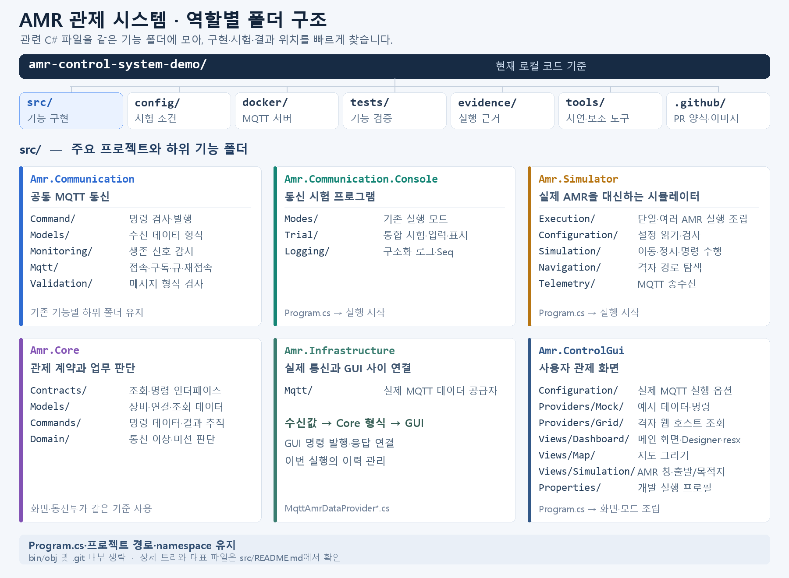

# 소스 폴더 안내

기능을 확인하거나 수정할 때 필요한 내부 폴더·대표 파일의 위치다. 프로젝트별 역할은 [루트 README](../README.md#source-projects), 실행 준비는 [BUILDING](../BUILDING.md), 확인 결과는 [evidence 색인](../evidence/README.md)에서 찾는다.

현재 로컬 코드에 있는 기능을 설명한다. 과제 전체 완료나 원격 반영 여부는 각 실행 근거와 Git 상태를 별도로 확인한다.

<a id="source-tree"></a>

## 실제 소스 폴더 구조



[이미지 확대](../.github/images/folder-structure.png) · [SVG 원본](../.github/images/folder-structure.svg). 아래 텍스트 트리는 실제 폴더명과 짧은 역할 설명을 함께 표시한다.

```text
src/
├─ Amr.Communication/          공통 MQTT 통신
│  ├─ Command/                명령 형식·발행
│  ├─ Models/                 수신 데이터
│  ├─ Monitoring/             생존 감시
│  ├─ Mqtt/                   접속·구독·큐·세션
│  └─ Validation/             유형별 메시지 검사
├─ Amr.Communication.Console/
│  ├─ Program.cs              콘솔 시작
│  ├─ Modes/                  기존 접속·수신·명령 실행 모드
│  ├─ Trial/                  통합 시험·입력·표시
│  └─ Logging/                구조화 로그·Seq
├─ Amr.Simulator/
│  ├─ Program.cs              시뮬레이터 시작
│  ├─ Execution/              단일·여러 AMR 실행 조립
│  ├─ Configuration/          설정 읽기·검사
│  ├─ Simulation/             이동·정지·명령 수행
│  ├─ Navigation/             격자 경로 탐색
│  └─ Telemetry/              MQTT 송수신
├─ Amr.Core/
│  ├─ Contracts/              조회·명령·미션 인터페이스
│  ├─ Models/                 장비·연결·조회 데이터
│  ├─ Commands/               명령 데이터·결과 추적
│  └─ Domain/                 관제 통신 이상·미션 판단
├─ Amr.Infrastructure/
│  └─ Mqtt/                   실제 통신→GUI 데이터 연결
└─ Amr.ControlGui/
   ├─ Program.cs              화면 시작·모드 조립
   ├─ Configuration/          실제 MQTT 실행 옵션
   ├─ Providers/
   │  ├─ Mock/                예시 데이터·명령
   │  └─ Grid/                격자 웹 호스트 조회
   ├─ Views/
   │  ├─ Dashboard/           메인 화면·Designer·리소스
   │  ├─ Map/                 지도 그리기
   │  └─ Simulation/          AMR 별도 창·출발/목적지 선택
   └─ Properties/             개발 실행 프로필
```

같은 역할의 partial 파일은 같은 폴더에 둔다. 이동한 C#69개와 화면 리소스1개의 내용·namespace는 유지했으며, 프로젝트 파일과 실행 명령도 같은 경로를 사용한다. [이동 전후 목록](../evidence/layout/20261101-role-folders-01/moves.json). 기존 실행 증거 안의 코드 경로는 당시 위치이며, 현재 위치는 이 목록으로 찾는다.

<a id="communication"></a>

## Amr.Communication — 공통 통신 라이브러리

관제와 AMR이 주고받는 MQTT 메시지를 검사하고 전달한다. trial과 실제 MQTT GUI의 연결부에서 재사용한다.

| 내부 폴더 | 담당 기능 | 대표 파일 |
| --- | --- | --- |
| [Command](Amr.Communication/Command/) | 이동·정지·복구 명령의 형식 검사와 MQTT 발행 | [CommandPublisher.cs](Amr.Communication/Command/CommandPublisher.cs) |
| [Models](Amr.Communication/Models/) | 검사된 위치·생존 신호·알람·응답 데이터 형식 | [ReceivedMessage.cs](Amr.Communication/Models/ReceivedMessage.cs) |
| [Monitoring](Amr.Communication/Monitoring/) | 생존 신호 수신·중단·복구 판정 | [SingleAmrHeartbeatMonitor.cs](Amr.Communication/Monitoring/SingleAmrHeartbeatMonitor.cs) |
| [Mqtt/Connection](Amr.Communication/Mqtt/Connection/) | 서버 설정·접속·접속 실패·해제 | [MqttConnection.cs](Amr.Communication/Mqtt/Connection/MqttConnection.cs) |
| [Mqtt/Subscriptions](Amr.Communication/Mqtt/Subscriptions/) | Topic 구독과 수신 메시지 검사·전달 | [MessageSubscription.cs](Amr.Communication/Mqtt/Subscriptions/MessageSubscription.cs) |
| [Mqtt/Queues](Amr.Communication/Mqtt/Queues/) | 장비별 수신 순서와 비동기 처리·종료 관리 | [AmrReceiveQueue.cs](Amr.Communication/Mqtt/Queues/AmrReceiveQueue.cs) |
| [Mqtt/Sessions](Amr.Communication/Mqtt/Sessions/) | 접속·구독·큐·생존 감시의 실행/종료, 재접속 조정 | [ControlCommunicationSession.cs](Amr.Communication/Mqtt/Sessions/ControlCommunicationSession.cs) · [ReconnectingCommunicationSession.cs](Amr.Communication/Mqtt/Sessions/ReconnectingCommunicationSession.cs) |
| [Validation/Common](Amr.Communication/Validation/Common/) | 공통 검사와 오류 형식 | [MessageValidation.cs](Amr.Communication/Validation/Common/MessageValidation.cs) |
| [Validation/Heartbeat](Amr.Communication/Validation/Heartbeat/) | 생존 신호 형식·필수 값 검사 | [HeartbeatValidator.cs](Amr.Communication/Validation/Heartbeat/HeartbeatValidator.cs) |
| [Validation/Telemetry](Amr.Communication/Validation/Telemetry/) | 좌표·속도·운행 상태 검사 | [TelemetryValidator.cs](Amr.Communication/Validation/Telemetry/TelemetryValidator.cs) |
| [Validation/Alarm](Amr.Communication/Validation/Alarm/) | 알람 코드·등급·발생/해제 값 검사 | [AlarmValidator.cs](Amr.Communication/Validation/Alarm/AlarmValidator.cs) |
| [Validation/Ack](Amr.Communication/Validation/Ack/) | 명령 응답의 ID·결과·사유 검사 | [AckValidator.cs](Amr.Communication/Validation/Ack/AckValidator.cs) |

명령 발행과 응답 전달을 담당한다. 실제 AMR의 이동 계산은 Simulator, GUI가 요청한 명령의 결과 추적은 Core·Infrastructure에서 담당한다. 복구 명령을 발행할 수 있다는 사실만으로 AMR의 RESET 수행이 구현된 것은 아니다.

<a id="console"></a>

## Amr.Communication.Console — 통신 시험 실행 프로그램

| 위치 | 담당 기능 | 대표 파일 |
| --- | --- | --- |
| [Modes](Amr.Communication.Console/Modes/) | 실행 옵션과 기존 접속·수신·생존 감시·명령 모드 선택 | [ConsoleRunner.cs](Amr.Communication.Console/Modes/ConsoleRunner.cs) · [CommandConsoleRunner.cs](Amr.Communication.Console/Modes/CommandConsoleRunner.cs) |
| [Trial](Amr.Communication.Console/Trial/) | 같은 창에서 통신 결과 확인·명령 입력, 입력줄 편집·보호 | [TrialConsoleRunner.cs](Amr.Communication.Console/Trial/TrialConsoleRunner.cs) · [TrialConsoleInput.cs](Amr.Communication.Console/Trial/TrialConsoleInput.cs) · [TrialConsoleDisplay.cs](Amr.Communication.Console/Trial/TrialConsoleDisplay.cs) |
| [Logging](Amr.Communication.Console/Logging/) | Serilog 구조화, 핵심 콘솔/상세 Seq 분리, Seq 전송과 실패 집계 | [TrialEventLogger.cs](Amr.Communication.Console/Logging/TrialEventLogger.cs) · [SeqLogSink.cs](Amr.Communication.Console/Logging/SeqLogSink.cs) |

trial의 기본 콘솔은 접속·단절·재접속·첫 수신·상태 변화·명령·응답을 표시한다. Seq를 설정하면 반복 위치·생존 신호도 상세 로그로 조회한다. [실행·명령·Seq 검색 안내](../tests/manual/COM06/README.md).

<a id="simulator"></a>

## Amr.Simulator — 실제 AMR을 대신하는 실행 프로그램

| 내부 폴더·파일 | 담당 기능 | 대표 파일 |
| --- | --- | --- |
| [Execution](Amr.Simulator/Execution/) | 단일/여러 AMR, 경로 실행/명령 대기 모드 선택·조립 | [SimulatorApplication.cs](Amr.Simulator/Execution/SimulatorApplication.cs) · [FleetApplication.cs](Amr.Simulator/Execution/FleetApplication.cs) |
| [Configuration](Amr.Simulator/Configuration/) | JSON 설정 읽기·검사, 장비 수·초기 위치·속도·경로 생성 | [SimulatorSettingsLoader.cs](Amr.Simulator/Configuration/SimulatorSettingsLoader.cs) · [FleetSettingsLoader.cs](Amr.Simulator/Configuration/FleetSettingsLoader.cs) |
| [Simulation](Amr.Simulator/Simulation/) | 좌표 이동·도착·정지 계산, 실행 간격, MOVE/STOP 수행과 결과 생성 | [SimulationRunner.cs](Amr.Simulator/Simulation/SimulationRunner.cs) · [CommandDrivenAmr.cs](Amr.Simulator/Simulation/CommandDrivenAmr.cs) |
| [Telemetry](Amr.Simulator/Telemetry/) | 위치·상태·생존 신호 송신, 명령 수신·최종 응답 송신 | [MqttSimulationSession.cs](Amr.Simulator/Telemetry/MqttSimulationSession.cs) · [MqttCommandSimulationSession.cs](Amr.Simulator/Telemetry/MqttCommandSimulationSession.cs) |
| [Navigation](Amr.Simulator/Navigation/) | 격자 경로 탐색·장애물 우회·길이 막힌 동안 대기 | [GridPathfinder.cs](Amr.Simulator/Navigation/GridPathfinder.cs) · [GridSimulation.cs](Amr.Simulator/Navigation/GridSimulation.cs) |

[기본 설정](../config/simulator.single.json)을 이용한 경로 실행과 `--command-mode --mqtt`의 명령 대기 실행을 구분한다. 격자 계산은 이 프로젝트에 있으며, 그 결과를 보여 주는 웹 호스트는 [tools/Amr.Simulator.Map](../tools/Amr.Simulator.Map/README.md)이다.

현재 명령 모드는 MOVE/STOP·도착/중단 응답을 구현한다. 장애 시점 설정의 읽기와 장애 알람 발생·해제의 실행은 다른 범위이며, RESET 수행·장애 시나리오 전체는 후속이다. [설정·실행 안내](Amr.Simulator/README.md).

<a id="core"></a>

## Amr.Core — 관제 데이터 계약과 판단

관제 계약·데이터·명령 추적·업무 판단을 각각의 폴더로 나눈다. MQTT 라이브러리·Windows Forms에 의존하지 않는다.

| 파일 | 담당 기능 |
| --- | --- |
| [IAmrDataProvider.cs](Amr.Core/Contracts/IAmrDataProvider.cs), [AmrSnapshot.cs](Amr.Core/Models/AmrSnapshot.cs), [AmrChange.cs](Amr.Core/Models/AmrChange.cs), [QueryModels.cs](Amr.Core/Models/QueryModels.cs) | 장비·알람·이력 조회 형식과 변경 알림 계약 |
| [ICommandDispatcher.cs](Amr.Core/Contracts/ICommandDispatcher.cs), [CommandModels.cs](Amr.Core/Commands/CommandModels.cs), [IAmrMissionPlanner.cs](Amr.Core/Contracts/IAmrMissionPlanner.cs) | 명령 요청·응답 표시·출발/목적지 조회 계약 |
| [CommandTracker.cs](Amr.Core/Commands/CommandTracker.cs) | 장비·요청 ID별 결과, 중복·상충 응답과 결과 대기 시간 추적 |
| [AmrDomainManager.cs](Amr.Core/Domain/AmrDomainManager.cs), [AmrDomainModels.cs](Amr.Core/Domain/AmrDomainModels.cs) | 격자/여러 AMR 경로의 통신 이상·관제 경보·미션 보류/재개 판단 |
| [DataConnectionSnapshot.cs](Amr.Core/Models/DataConnectionSnapshot.cs) | Broker 연결과 AMR 생존·수신 위치의 유효 상태 표시 형식 |

이 파일들이 존재하는 것을 과제4 전체 완료로 판단하지 않는다. SQLite 이력 저장은 현재 소스 구성에 포함되어 있지 않다.

<a id="infrastructure"></a>

## Amr.Infrastructure — 실제 통신과 GUI 계약 연결

실제 MQTT 공급자 파일은 [Mqtt](Amr.Infrastructure/Mqtt/)에 둔다. Core 계약을 구현하고 Communication의 재접속 세션을 사용한다.

| 파일 | 담당 기능 |
| --- | --- |
| [MqttAmrDataProvider.cs](Amr.Infrastructure/Mqtt/MqttAmrDataProvider.cs) | 통신 실행/종료, 연결·생존·수신 상태 변환, GUI 조회와 변경 알림 |
| [MqttAmrDataProvider.Commands.cs](Amr.Infrastructure/Mqtt/MqttAmrDataProvider.Commands.cs) | GUI의 MOVE/STOP 요청·발행·ACK 연결, 수신 알람, 목적지와 실행 중 이력 관리 |

현재 한 공급자는 지정 AMR 한 대를 관리한다. 이력은 이번 실행의 메모리에 보관한다. trial에서 보낸 외부 명령은 GUI 자체 요청으로 등록되지 않으며, GUI는 수신한 위치·상태를 표시한다. 실제 요청·최종 ACK·화면의 동작 확인은 [GUI 연동 안내](../tests/manual/GUI-CONTROL/README.md)를 따른다.

<a id="gui"></a>

## Amr.ControlGui — 사용자 관제 화면

화면은 `Views`, 데이터 공급자는 `Providers`, 실행 옵션은 `Configuration`으로 나눈다. `Program.cs`는 루트에 두고, `Properties`에는 개발 실행 프로필을 둔다.

| 파일·폴더 | 담당 기능 |
| --- | --- |
| [Program.cs](Amr.ControlGui/Program.cs), [MqttGuiOptions.cs](Amr.ControlGui/Configuration/MqttGuiOptions.cs) | 실행 모드·서버·대상 장비 설정과 공급자 조립 |
| [MainForm.cs](Amr.ControlGui/Views/Dashboard/MainForm.cs), [MainForm.Designer.cs](Amr.ControlGui/Views/Dashboard/MainForm.Designer.cs), [MainForm.Feedback.cs](Amr.ControlGui/Views/Dashboard/MainForm.Feedback.cs) | 대시보드·장비/알람·조회 화면 구성과 화면 갱신 |
| [MainForm.Mqtt.cs](Amr.ControlGui/Views/Dashboard/MainForm.Mqtt.cs), [MainForm.Grid.cs](Amr.ControlGui/Views/Dashboard/MainForm.Grid.cs) | 실제 MQTT/격자 호스트 데이터의 화면 연결 |
| [MapCanvas.cs](Amr.ControlGui/Views/Map/MapCanvas.cs), [MapCanvas.Grid.cs](Amr.ControlGui/Views/Map/MapCanvas.Grid.cs) | 좌표·출발/목적지·격자·장비 표시와 확대/축소 |
| [SimulationForm.cs](Amr.ControlGui/Views/Simulation/SimulationForm.cs), [SourceSelectionForm.cs](Amr.ControlGui/Views/Simulation/SourceSelectionForm.cs), [DestinationSelectionForm.cs](Amr.ControlGui/Views/Simulation/DestinationSelectionForm.cs) | 선택 AMR의 별도 창·이동/정지, 모드에 따른 출발/목적지 설정 |
| [MockAmrDataProvider.cs](Amr.ControlGui/Providers/Mock/MockAmrDataProvider.cs), [MockAmrDataProvider.Simulation.cs](Amr.ControlGui/Providers/Mock/MockAmrDataProvider.Simulation.cs), [MockCommandDispatcher.cs](Amr.ControlGui/Providers/Mock/MockCommandDispatcher.cs) | 화면 개발용 예시 데이터와 명령 동작 |
| [GridMapDataProvider.cs](Amr.ControlGui/Providers/Grid/GridMapDataProvider.cs) | 격자 웹 호스트의 상태를 HTTP로 조회해 Core 계약으로 전달 |
| [Properties](Amr.ControlGui/Properties/) | Visual Studio의 개발 실행 옵션 |

| 실행 모드 | 데이터 출처·확인 범위 | 실행 안내 |
| --- | --- | --- |
| 인자 없음 | Mock 예시 데이터로 화면·조작 확인 | [Mock 실행](../BUILDING.md#windows-forms-mock-대시보드지도) |
| `--mqtt` | Infrastructure를 통해 지정 AMR의 MQTT 위치·상태 수신과 MOVE/STOP·응답 확인 | [실제 GUI·AMR](../tests/manual/GUI-CONTROL/README.md) |
| `--grid-url` | 격자 웹 호스트가 가진 수신 위치·상태/미션 정보 조회 | [격자 연결](../BUILDING.md#windows-forms에-격자-mqtt-상태-연결) |

실제 MQTT 모드의 초기 좌표는 AMR 설정 파일에서 변경한다. 별도 창을 닫으면 창만 닫히며, 실행 중인 AMR 이동은 계속된다. 화면의 이번 실행 이력과 DB 영속 이력을 구분한다.
